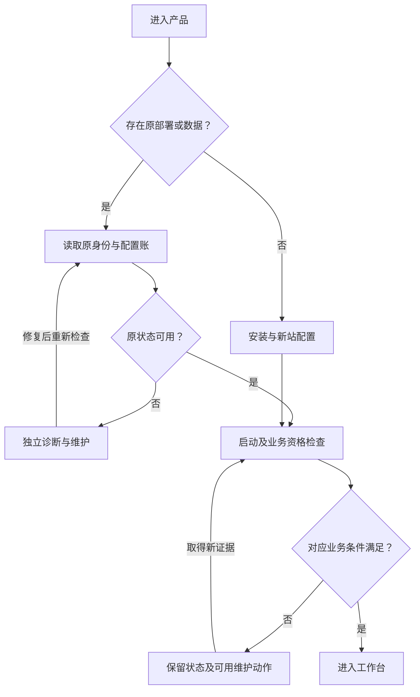

# 商业化产品设计 · COMMERCIAL-PRODUCTIZATION-01

> 实施接续：本页保留 c445b0e 文档任务/静态基线及原计划状态。当前 COMM-00～10 实现、实际结果与外部门槛见[实施结果](../runtime/commercial-productization-01-results.md)；不能把本页初始 NOT_RUN 或“仅文档”语境当作本次实施禁令。
状态：**DESIGNED，待实施**。分析日期：2026-10-19；代码基线：`b8f449ec91f8f7efd8bc5079ca38e19bc877ebf5`。本文定义客户可感知行为、状态及责任边界，不把目标设计写成已完成功能。实现任务和完成条件分别见[主工作包](../work-packages/WP-IPC-COMMERCIAL-PRODUCTIZATION-01.md)、[实现逻辑](../implementation/commercial-productization-01.md)、[必要验收](../runtime/validation/commercial-productization-01.md)。本轮未执行的运行、Windows、设备及现场验收均为 **NOT_RUN**；缺少真实接口/SDK/资格的生产路径继续 **BLOCKED / NotReady**。

> 2026-10-20 安装交付范围已收敛为普通人工安装包和必要说明，详见[范围收敛与检查结论](../runtime/installation-delivery-scope-01.md)。本次范围修订优先于下文旧计划中相应的批量安装要求；历史实现和验证记录保持原身份。

## 1. 产品目标与继承边界

目标是让客户能够完成“取得正确软件 → 安装 → 配置工位 → 判断是否具备开工条件 → 连续操作 → 定位并恢复异常 → 升级和维护 → 保留可追溯资料”的完整过程。减少用户手工维护 JSON、路径、散列和内部编号的工作；每项自动化仍需有明确输入、可靠结果、失败后的可继续路径和可导出的证据。

沿用[框架](framework.md)、[F 决策](framework-decisions.md)和[独立 Application 架构](application-architecture-22.md)：基座负责机制，Application 拥有业务规则、状态、命令守卫及所属 UI，驱动负责设备，组件负责外部服务适配。一个已打包 Application 对应独立主业务；导航和布局复用同一运行实例、连接、发送器及状态，不引入运行时“切换任意业务”的万能流程。

Sportmaster 保留读码、请求上游目标、展示格口以及左右独立业务链，不增设 PLC、图片显示或长期图片保存。历史 Supply 视觉基线中的共享箱、拆包、数量字段不得套入 Sportmaster；WcsToPlc 独立适配自己的业务，DirectPlc 完整业务 UI 延期不变。跨产品共用的是部署、设置框架、健康表达、诊断和样式机制，页面字段及动作仍由各 Application 决定。

“工业级”在本包中对应可验证的持续运行、权限隔离、数据完整性、失败恢复、兼容升级和交付可追溯要求，不代表已通过某项工业认证，也不以增加页面数、框架层数或测试数量衡量质量。

## 2. 最新基线：已有能力与真实增量

|领域|当前 main 的事实|本包补齐的产品行为|
|---|---|---|
|安装|已有实际 WPF 四步向导、媒介核验、运行账户/数据根/配置来源选择、离线扩展文件选择、受保护并排部署、开始菜单和最终部署登记|支持经校验的程序安装根选择；可理解的组件目录与系统依赖处置；系统安装登记、维护和卸载闭环；恢复安装进度及一致结果说明|
|首配|安装仍要求选择含 `business.json` 的配置目录；离线维护可修改既有能力参数及基础策略，站/模式/拓扑/提供者版本/设备身份保持原值；未确认配置启动及 Production 精确资格仍有限制|面向新工位的完整首配表单和模板导入；按已打包能力选择设备、绑定左右、配置所选 RCS/WCS；可恢复草稿，并补齐新站初始化及未确认配置的受控修复转换|
|启动失败|已有重试启动、离线维护、安装修复、支持摘要入口；进入维护前必须完成原实例停止与释放|将故障分类、影响、原责任、可用动作与进展统一展示；正常安装、首配、启动修复之间能够正确返回和继续|
|配置|已有原数据根内唯一配置修订账、Effective/Pending、原因、原字节保全、CAS、受保护 helper 和所有权锁|统一信息架构、字段解释、差异及生效影响；首配和运行内/离线维护共用配置权威；变更冲突保留草稿|
|备份恢复|已有完整备份机制及原生恢复预检、选新目录、固定备份身份、恢复后隔离和重新读取|可浏览的备份清单、状态和计划；备份策略、容量预估、迁移向导及维护说明，复用原恢复引擎|
|账户与启动|指定 Windows 账户以未提权令牌运行；允许 UAC 过滤后的管理员用户；真正提权、错误 SID、服务/系统账户被拒绝；普通 Setup/Maintenance/启动不依赖 PowerShell|各入口、提示、安装文档与这一最终政策一致；应用角色与 OS 安装权限分别表达|
|发布|main 合并了原生部署和全部运行入口身份门禁；两组现有 Release 来自不同冻结源码|新商业化候选从一个固定组合源码构建，程序、扩展、配置 schema、数据库、指南及包散列成套；不得给旧 ZIP 改标签冒充组合验证|

事实依据：[原生工作流源码](../../src/Ipc.Desktop/StartupWorkflows.cs)、[Windows 部署机制](../../src/Ipc.Platform/WindowsDeploymentSetup.cs)、[安装及维护装配](../../src/Ipc.Assembly/ParcelStartupServices.cs)、[独立离线维护](../../src/Ipc.Application.ParcelFlow/ParcelStartupMaintenance.cs)、[当前使用指南](../runtime/startup-deployment-02.md)、[冻结候选的历史结果](../runtime/startup-deployment-02-results.md)、[合并与发布差异](../runtime/publication-deployment-20261019.md)。这些源码/历史记录不构成本包的执行验证。

## 3. 信息架构与角色

日常入口围绕用户任务组织：**工作台、记录、异常、设备与服务、设置、维护与帮助**。实际导航数量和抽屉/页面形式可由实现者依照有效客户区与原 UI 实物选择；同一职责只设一个清晰主入口，离线维护保留独立启动入口。生产操作层展示“当前状态、影响、下一步”，协议报文、包版本、修订散列等收纳到相应详情；Application 名、运行模式和真实生产未就绪状态仍持续可见。

|身份/权限|常规行为|边界|
|---|---|---|
|日常操作者|本 Application 已批准作业、查看当前故障及获准历史、软件暂停/恢复的对应动作|按钮能力由应用契约投影；命令执行时再次检验权限与原作业版本|
|应用维护人员|在已批准权限内编辑业务配置、查看详细诊断、执行受控恢复|应用维护权不自动授予 Windows 管理权或强制接受业务的权利|
|Windows 安装/维护管理员|经固定提升入口安装、修复、受控离线保存和备份恢复|只执行审核后的固定操作；提权过程不加载任意扩展，不代替日常运行身份|
|已批准免登录模式|明确显示“按配置免登录”，运行其限定能力|不创建虚假的已认证用户；不升级为匿名全权限；未选认证组件不应阻断本可免登录的基本配置|

登录功能、特殊处置权限及换班行为按产品批准配置和实际身份合同提供。首配/诊断不能要求业务登录先成功，业务用户凭据不用于安装提权。商业化不新增统一强制操作员登录，也不取消当前 Production 的维护认证能力和精确部署资格要求，不擅自建设一套客户账号中心。

## 4. 分层状态模型

### 4.1 安装、配置、激活、连接、业务分别表达

以下是产品语义，不要求把名称逐字实现为新枚举或另建状态库。

|状态维度|必要状态/证据|典型文案与后续动作|
|---|---|---|
|软件安装|未安装、计划待授权、执行中、等待重启、已安装、部分完成/失败；有操作及产物身份|“程序已安装，工位配置尚未完成”；查看失败步骤、继续或修复|
|组件库存|未选择、未安装、已安装、依赖缺失、不兼容、库存异常|“读码组件已安装，缺少其批准版本运行依赖”；查看具体依赖|
|配置修订|未配置/草稿、静态校验通过、待生效、已生效、激活失败/冲突|并列显示当前生效值及待生效值；保存、重读比较或受控激活|
|运行资源|未启动、连接中、已连接、能力就绪、断开、重连中、故障、未知/过期|展示来源及最近确认；不能用旧绿色表示当前在线|
|业务资格|不适用、条件不足、待核对、软件暂停、允许对应动作|显示哪项条件阻断哪种动作；连接成功不能直接写“可以开工”|

“安装了相机驱动”不表示已绑定相机；“RCS 已配置”不表示真实合同合格；“连接测试通过”不表示允许创建业务请求。可选组件失败仅影响真正依赖它的功能；已经选作必需能力的组件缺失时必须阻断对应业务，不能无声换成模拟实现。

### 4.2 总体进入路径

打开应用界面不等于自动恢复生产。恢复隔离、未决请求、配置激活、设备及实体许可由各自守卫决定；关闭某个提示不能解除这些责任。

## 5. COMM-01：安装设计

保留当前真实原生向导及其维护机制，扩展为连续、可回退的客户流程。典型步骤如下，允许合并无选择的页面，不能为了模仿商业软件增加空步骤。

|步骤|用户需要理解或选择|执行与失败语义|
|---|---|---|
|产品与环境检查|产品/Application、版本、适用系统、发布者来源；首次安装或维护已有安装|核验完整媒介及来源，显示确切失败项；未核验不进入安装执行|
|安装位置|程序根、数据根、已有运行账户；显示预计空间及升级是否保留原位置|程序与可写业务数据分离；只接受可验证安全的本地目标，身份及既有目录冲突需明确解释|
|组件与依赖|锁定的核心、可选相机/读码驱动、RCS/WCS 等组件；显示用途、精确版本、大小、系统依赖|默认采用产品推荐集合；依赖随选择可见；不提供无依据“安装全部品牌”，不运行插件探测来生成目录|
|确认计划|实际变更、保留项、重启要求、授权账户、安装及数据路径|摘要固定本次输入与媒介/包身份；返回修改后必须重新计算，避免执行旧摘要|
|执行|按实际步骤显示校验、依赖、复制、登记及结果|耗时未知使用真实阶段状态，不虚构进度；允许安全取消的阶段明示；UAC 取消保留输入并可重试|
|结果与继续|程序已安装/需重启/部分失败；安装日志、首次配置、正常启动或修复入口|结果以持久回执及实际读回为准；不能所有步骤绿灯而必要依赖仍失败；失败保留旧可用登记与原数据|

程序根默认沿用当前受保护位置，支持选择其他满足保护条件的根；校验必须同步覆盖请求摘要、提升 helper、文件集合、ACL、完整路径和部署登记，不能只改 UI 文本或复制位置。普通运行账户只能读取/执行安装文件，不能因选择自定义目录获得替换程序、策略或 helper 的能力。数据根默认及升级行为沿用已登记结果，不悄悄从 `%LOCALAPPDATA%` 迁往新目录，也不自动通过新建空根绕开旧责任。

原厂 OS 驱动、厂商 SDK/运行库和应用内适配组件分别展示。仅能分发有明确许可及兼容证据的原包；不能从未知来源下载、猜厂商安装参数，或在提权阶段执行应用扩展代码。外部安装器可能产生需重启/部分完成结果，必须独立记录和复核；不能宣称任意外部依赖均可由本软件原子回滚。正常安装、首配及基本维护无需客户安装 PowerShell。

安装交付采用已有原生向导及部署内核，验收普通用户可完成安装、首次配置和启动，能查看依赖/权限要求及失败原因，升级保留配置和业务数据，修复/卸载有明确入口与说明。保留可信来源、稳定版本身份和可发现的系统安装信息。不要求无人值守参数、响应文件、批量编排、更换安装器或单独的选型 ADR；确有具体缺口时按缺口处理。

## 6. COMM-02：首次配置、相机与 RCS

### 6.1 何时进入及如何继续

首次配置在程序安装完成后、业务资源启动前提供，可从安装结果、正常首次启动或独立配置入口进入。依据安装身份和实际配置状态判断是否完成，不只存一个 `FirstRunCompleted` 布尔值。即使相机不在场、RCS 暂时不可达或某个可选扩展缺失，客户仍能读取、填写和保存非权威草稿，完成当前可执行的验证；能否提交 Pending 或激活继续满足完整配置、精确部署资格及原责任条件。界面必须明确哪些验证尚未执行、哪些业务仍被阻断。

先只读发现原部署、原站/模式和唯一配置账。**全新工位**可根据当前 Application 允许的部署规格输入新身份；**已有工位**显示原身份和修订，走修订或迁移流程。原账损坏、原库存在而配置账缺失、存在未决责任时不得降级成“欢迎首次使用”并建立空账。

首配草稿可退出后继续，绑定产品版本、安装/站身份、模板版本和原配置基线；只承载待验证输入及进度，不成为第二套生效配置。敏感字段按实际凭据机制保存引用，不把密码作为普通草稿/日志；环境或原配置变化后显示差异并重新验证。保存、配置生效、开始作业是三个独立结果。

### 6.2 表单顺序与字段来源

|页面|内容及来源|校验与后续|
|---|---|---|
|导入或新建|使用批准模板，或创建当前 Application 的新站配置；先显示产品/模式和模板来源|导入前预览，检查 schema、Application、允许能力和敏感字段；已有数据不能被导入模板覆盖|
|工位基本信息|站标识、显示名称、当前 Application 需要的位置/线路信息；数据位置从安装登记读取|只呈现该业务实际拥有字段；区分字符串标识、显示名称和外部业务身份，不杜撰客户编码格式|
|相机/读码来源|已选驱动、实际可枚举设备的稳定身份、业务角色及左右对应|若 SDK 支持枚举则呈现真实发现结果；离线允许填写经确认的稳定标识，保持“未发现/未验证”；不把列表顺序、瞬时 IP 或 CAM0 标签作为永久设备身份|
|RCS/WCS 等所选组件|具体适配器声明的地址、实例/站映射、超时、认证引用及其他 schema 字段|只问本次已选且该业务需要的项；字段含单位、合法范围、必填依据和生效影响；不假定所有 RCS 有同样协议和接口|
|校验与能力确认|静态配置、依赖兼容、身份绑定、凭据可用性、可允许的只读连接检查|逐项区分通过、失败、未执行、不适用及需现场确认；业务有副作用检查另列，不借“测试连接”创建任务、发车或写 PLC|
|预览与保存|配置差异、未完成事项、允许的功能、受控激活/重启要求|草稿保存与提交待生效修订分开；满足提交条件才进入原唯一配置账并读回；未具备 Production 资格时保留草稿及诊断，不伪装 Pending/Effective 或已可生产|

左右绑定用业务角色与稳定设备身份双向展示；重复绑定、同一设备不允许的双重占用、找不到原设备均有具体处理提示。交换左右是受控配置变更，需要相关资源停止和重新确认，不能因窗口焦点或设备枚举顺序发生交换。Sportmaster 的读码验证只展示码与来源，不扩展成相机画面或图片留存功能。

RCS 任务身份/数字范围沿用其现有批准合同和持久分配规则。新站模板不得包含已使用的任务序列、请求 ID、租约、历史库或运行中的认证会话；备份迁移同一工位时则必须保留相应原责任，不能重新从默认数字开始。相关工程约束继承 [Sportmaster RCS 设计](sportmaster-rcs-task.md)。

### 6.3 配置验证分层

静态验证不构造 reader/SDK、不建立业务运行实例；依赖和库存检查报告精确模块身份。连接检查必须具备明确的无副作用合同及维护前提，持续显示结果时间和适用配置版本；若 SDK 的“打开/启动”本身会取得控制权，则归入受控设备检查，不能伪装为只读表单校验。Production 所需实体、协议、资格不明时仍拒绝相关业务，不能因为用户选中“已完成”就绕过。

最新代码存在必须落地处理的首配闭环缺口：[ParcelRuntime.StartAsync](../../src/Ipc.Application.ParcelFlow/ParcelRuntime.cs) 在 `Confirmation.Required` 时不尝试 Pending，随后仍校验并构造原 Effective。若原 Effective 不能启动，仅用现有离线 Stage 保存 Pending 无法保证完成修复。[ParcelCapabilityFactory.ValidateDeployment](../../src/Ipc.Assembly/ParcelCapabilityFactory.cs) 同时在 Production 路径要求与配置散列、合同及安装能力匹配的部署资格；现有离线保存会调用该验证，不能把“可离线填写”描述成“任意 Production 候选均可提交生效”。

因此首配须按以下层次呈现并实施，不通过削弱现有验证制造顺畅演示：

|层次|可持久化结果|与业务权威的关系|
|---|---|---|
|输入尚不完整、组件/资格待补齐|绑定原身份和基线的非权威草稿及验证清单|允许关闭后继续；不能由正常运行加载为 Effective/Pending，也不声称已配置完毕|
|完整候选具备当前提交资格|经同源校验、原字节保全、权限及 CAS 检查的待生效修订|沿用唯一配置账；提交成功不跳过启动确认、原责任、连接及实体许可|
|全新工位初始化，或原未确认配置无法启动|由 Application 拥有的明确初始化/受控修复转换及其回执|判定确为新站或明确原失败范围，核验原配置与所有责任、候选精确资格、所有权和中断恢复；保留原字节与转换记录，再进入既有受控启动/确认体系|

最后一层需要实现明确的应用命令、状态转换与恢复语义，不能仅将 `Confirmation.Required` 清为 false、直接覆盖 Effective，或临时用 Simulation 配置绕过 Production 门禁。无法证明原责任已清偿时只开放草稿、诊断和允许的核对动作；缺少匹配资格时说明所缺材料及候选身份，不能由安装管理员代造资格。候选字段变化后原连接检查及配置散列资格都须重新判定，不沿用已失效的验证结果。

## 7. COMM-03：统一设置与生效设计

设置按“工位、设备与绑定、外部服务、作业策略、展示与声音、数据与维护”组织；按 Application 裁剪，保持一次解释、多个入口共用。同一字段在首配、运行内维护及离线维护中使用同一元数据、验证与脱敏规则，避免三套表单逐渐分叉。

每个关键设置展示当前生效值、正在编辑的草稿、待生效修订、单位和应用条件。默认先查看和编辑，提交时展示必要差异与影响；格式尚未填完只影响相应字段提示，不通过全表校验阻止选择一个无关字段。取消编辑不撤销已提交的待生效修订，撤销/替换待生效修订是单独的受控操作。

|变更类型|生效策略|必须保留的事实|
|---|---|---|
|纯展示偏好|确认无业务影响后可即时生效|不改变实体映射、条码来源、业务规则或运行模式|
|业务策略/参数|经 Application 完整验证及权限检查，形成新修订；按影响要求维护条件和受控激活|原有效配置、待生效差异、操作者、原因及失败回执|
|设备身份/角色、服务目标、包版本|先评估原责任和依赖，停止受影响资源；默认受控重启及重新确认|旧连接代次失效；旧请求仍固定原目标、合同、报文及包身份|
|站/模式、数据根、数据库格式|独立部署/迁移计划；已有站不在普通表单直接改名重建|原部署、完整备份、责任范围、兼容关系和恢复隔离|

检测到其他页面/维护进程修改原账时，不以最后保存覆盖；保留用户草稿，重新读取，展示逐项差异，由用户重新确认。激活失败展示“当前仍使用哪个版本、哪个步骤失败、可采取什么行动”；不得写假生效状态。受控重启负责暂停新业务、处理在途责任、停止与释放、启动、恢复检查；重启成功后是否恢复入场仍由对应业务守卫决定。

## 8. COMM-04：日常作业和持续运行体验

修改 UI 前必须阅读[视觉原件入口](../ui/ss-ui-vis-001-v1.1/README.md)、[完整图册](../ui/ss-ui-vis-001-v1.1/GALLERY.md)、[原 HTML](../ui/ss-ui-vis-001-v1.1/供包工作站_高保真交互原型.html)、[分离 CSS](../ui/ss-ui-vis-001-v1.1/prototype/workstation.css)、[分离 JS](../ui/ss-ui-vis-001-v1.1/prototype/workstation.js)及[完整开发交接](../ui/ss-ui-vis-001-v1.1/docs/供包工作站_UIUX设计与开发交接说明.md)。本设计已阅读其源文与交接；原 HTML/CSS/JS 中的模拟流程、固定时间、共享 gate、示例数量/身份和业务缺陷不是生产实现依据，原图与 Windows 运行图的证据身份分开。

主工作台稳定呈现当前业务对象、左右来源、最近结果及原因、下一步动作、关键全局条件。主要结果与操作位置稳定；长条码可完整选择/查看并保留前导零，长故障原因允许局部滚动。结果到达不清空用户尚未提交输入，不抢占焦点或重置历史筛选和详情位置。处理“未识别”“未取得目标”“上游已接受”“结果待核对”时保留其不同语义；Sportmaster 取得格口不得统计为已完成物理分拣。

辅助视图采用与现场操作相匹配的方式：只读页面不自动产生业务暂停，若阻断操作员观察主作业则必须按实际 Application 风险设计持续故障区、可返回动作和对应暂停条件。任何页面打开都不停止原后台接收/核对，关闭也不创建第二运行实例。需要暂停的交互必须明确显示其作用域，并通过应用命令完成；不能依赖弹窗是否可见控制业务。

键盘操作具有清晰焦点域：扫码终止符只提交相应输入，不触发全局高风险默认按钮；Tab 顺序、Esc 可取消范围、弹窗返回焦点、重复点击和忙态扫描处置可预测。输入繁忙时新扫描若无法接收，明确提示未接收与后续动作，不静默丢弃也不猜测重用上一条码。

WPF 布局沿用既有资源和视觉层级，以有效客户区适配，记录物理屏幕、系统缩放和实际客户区。允许重排、折叠低频信息和局部滚动；业务按钮触控目标以既有 44 DIP、主要操作 48～52 DIP 作为设计参考，实际视距/手套/DPI 可用性须后验。布局不足的限制按当前必需信息和动作判断，不因某个隐藏的低频入口永远禁止作业；也不把整页缩小后的可见等同可读可操作。Windows 键盘、触控、混合 DPI、多屏与声音验收为 **NOT_RUN**。

声音按真实应用事件和发生身份去重，支持试听、音量/允许范围内静音以及与文字并行的持续异常表达；低频提醒不能淹没关键故障，设置声音不能删除故障本身。不自动加入换肤、大屏动画或与日常任务无关的统计面板。

主要输入、按钮、错误及关键动态状态须提供可读的名称、用途、值和可用性语义；焦点顺序与视觉任务顺序一致，状态更新避免反复播报淹没关键变化。把代表性读屏操作并入同一次 Windows 主任务验收，不以键盘可用代替读屏可用。

## 9. COMM-05：设备健康、异常与恢复

### 9.1 设备与服务中心

每项能力展示业务用途、设备/实例、提供者及实际版本、配置修订、连接/能力/业务状态、来源更新时间、最近错误和允许操作。枚举缺失、未安装依赖、配置失败、连接失败、认证失败、协议不兼容、业务拒绝分别表达。必须显示“已安装但未启用”“已连接但能力未就绪”“状态已过期”，不以一个总绿点掩盖差异。

“重新连接”只操作明确受影响资源，遵守其停止屏障和原控制权；不能直接把健康设为 Ready，不能影响另一 Application/工位，也不能自动清除 Unknown。SDK 重启、提供者变更等行为由既有生命周期实现，界面只发起应用/维护契约允许的动作。

### 9.2 异常卡片与动作分类

异常持续呈现“发生对象、当前事实、影响范围、下一步、发生/最后确认时间”；同一发生具有稳定 ID。已读只是确认看见，恢复需要来源证据；多来源故障不能合并成一个可手动写绿的总状态。

|问题类别|可以提供的动作|不得混淆的结果|
|---|---|---|
|只读查询/页面加载失败|重新查询、调整筛选、查看诊断|查询失败不是没有记录；重新查询不发送业务|
|安装/配置错误|修正对应项、重新验证、离线维护或重新计算安装计划|安装完成、配置已保存和已生效分别回执|
|设备/服务失联|查看线缆/地址/凭据诊断；在允许条件下重新连接|连接恢复不代表原请求已处理或实体已复位|
|明确业务拒绝|查看原原因、核对当前对象、按已批准业务流程纠正|不能提供无条件原样重试或手工标成功|
|结果未知、回执保存责任|打开原请求核对、权威查询（仅合同支持时）、导出专属证据|Unknown 不自动重发；原身份、原目标、原报文和旧包不得被当前配置替换|
|存储失败、容量不足、配置账损坏|保持原现场材料，暂停受影响业务，容量处置/完整备份恢复|不能删除原库、重建空账、清租约换绿灯|
|软件暂停|解除操作者这一个暂停原因；重新计算当前资格|不会解除设备、身份、存储、未决责任或实体许可阻断|

恢复向导应先列出未决项并允许按业务对象选择，显示原作业/请求及证据时间；不要求客户从日志复制内部恢复 ID 才能找到对象。真正不可省略的理由或外部证据在对应动作中填写；核对结果冲突、版本过期时保持待核对，不以界面最后操作覆盖新事实。软件暂停仍不是安全急停，不把本包扩展为 PLC 点动、AGV 强制动作或远程复位控制台。

## 10. COMM-06：历史、导出与指标

历史列表按 Application 定义的业务对象呈现，支持日期/时区、条码、通道、结果、任务/请求标识及必要原因筛选、分页和稳定排序。详情沿“作业 → 请求 → 发送尝试 → 回执/原件责任 → 配置和审计”追踪；同一条码可以对应不同作业，同一作业多次网络尝试不新增业务计量。迟到回执归属原作业，不能刷入当前通道或新箱。

导出明确选择范围、筛选条件、列、时间基准和数量，提供进度、取消、空间不足及完整结果回执。查询与导出有页大小、时间/条数/字节预算，不全量载入内存；失败保留明确的未完成文件状态，不宣称部分导出成功为完整结果。导出只包含权限内数据，默认不附原始数据库、秘密、图片或无关诊断。

条码、格口、任务号及请求 ID 作为字符串；面向电子表格的格式需防止自动数值化丢前导零及公式执行，不能只用 CSV 引号声称解决两者。格式选择由实际需求和现有依赖决定，原始可追溯导出需保留精确文本、schema、产品版本和筛选元数据；做了表格安全转换时说明转换，不能覆盖原历史事实。

指标必须有名称、事件来源、单位、时间区间、分母和未完成状态处理规则。例如分别展示“识别作业数”“取得上游目标数”“业务接受数”“待核对数”；只有取得批准物理完成事件的 Application 才提供“物理完成量”。无事件来源的数字不补零，吞吐/延迟在所选证据范围内统计，不把回调频率、请求尝试数或演示场景作为实际生产节拍。

## 11. COMM-07：升级、修复与卸载

升级面向一个固定产品组合：Application、主程序、公共契约、扩展包、配置 schema、DB 格式、安装器和随包指南记录确切对应。升级计划先检查当前部署、未决请求/接收原件责任、依赖兼容、完整备份及容量，说明是否需要原匹配宿主先完成维护过渡。显示计划并受控停止后再执行，不能运行中静默替换二进制或让旧请求跟随新目标。

程序并排部署及最终登记策略继续复用；数据库升级和配置激活分别报告，不因安装器可回退程序就宣传“任意一键回滚”。旧程序不能打开不支持的新库。失败时显示现用版本、已完成步骤、保留数据及受限状态；恢复旧完整备份进入隔离核对，不能自动补发恢复时看似未发送的请求。

修复分为“程序/资源文件修复”“配置修订”“完整数据恢复”。程序修复校验并还原本版允许文件，不覆盖生效账、历史业务数据、批准信任或现场凭据；缺少原批准包时给出精确身份，不能取任意同名最新版替代。政策/SID 不明确时不静默重绑账户或删除机级租约。

卸载从系统可发现入口进入，默认保留业务数据、日志/审计、备份、必要政策及责任材料，明确程序、快捷方式、受共享引用组件的处理范围。运行中禁止移除；停用后按部署、待生效修订、未决原请求、原件和备份消费者计算可删除、须保留或须转入离线保管的文件，展示具体原因和处置路径。有原责任时保留所需匹配版本与核对入口，不以卸载解除责任。共享驱动/运行库仅按已证实的所有权及供应商规则处置，不能因为本应用卸载就盲删。业务数据销毁、机级责任清除和工位正式退役属于独立明确操作及授权范围，本包不增加默认清空选项。

## 12. COMM-08：备份、恢复、迁移与容量

备份中心复用一致性备份与 `.recovery` 完整集合，展示来源工位/Application/模式、创建时间、代码/DB/配置版本、大小、校验状态、位置及可恢复条件。计划备份需有启用状态、触发策略、最近成功/失败、下次条件和容量预算；在客户端未运行时是否执行由部署模式明确约定，不能暗中新增 Windows 常驻服务。触发时仍须满足原维护权限、一致性窗口及责任条件，不能悄悄暂停生产或绕过守卫；条件不足显示待执行及原因。旧文件存在不等于备份有效。

恢复流程延续“选完整集 → 预检 → 查看计划 → 固定备份身份 → 在新根执行 → 读回 → 保持隔离 → 核对后决定业务”的现有能力。预检不创建目标，源 DB 与恢复伴随集合都固定身份，执行再校验，不覆盖已有目标。恢复进度/取消按引擎安全边界展示；恢复时原目录与证据保留，禁止原根和新根同时操作同一硬件。

迁移区分同一工位换电脑/换盘与创建新工位：前者传递原身份、配置、未决请求、序列和完整责任，执行受控恢复及原实例退场；后者只用批准配置模板重新指定站、设备、凭据和唯一范围。不得将已使用数据根复制多份作为批量部署方案。

容量策略分别覆盖 DB/WAL、原件/未决证据、日志、备份、导出和维护临时副本。界面说明预计空间、保留策略和具体阻断项；清理只处理批准保留期外且无业务/审计引用的可清理数据，未决及所依赖包、配置、回执不可自动删除。压缩/清理失败不能隐藏；低水位先提醒、写入无法保证时阻断对应新业务。保留时间、目标容量和现场峰值由实际合同/测量确定，默认值不能冒充承诺。

## 13. COMM-09：诊断、帮助与支持

帮助中心可在离线、未登录、业务启动失败时打开，按安装、配置、设备、业务拒绝、结果未知、存储/升级分类。关键错误提供稳定错误码、可理解解释、影响、下一步以及对应离线帮助链接；内部异常堆栈可收纳进详细诊断，不能把堆栈作为唯一客户提示。软件文案与同版指南同步，失效链接或不适用旧指令不能继续列为当前操作。

支持摘要与详细诊断包分级。摘要沿用已有不含配置参数、报文和 DB 的出口；详细包由用户选择时间/对象范围，生成前说明文件种类和脱敏结果，包含精确产品/发布来源、配置修订身份、设备/服务健康、错误链及必要日志。秘密、凭据引用的秘密值、连接串敏感部分及超范围业务数据不进入普通日志或默认包。导出设置大小和时间预算，完整性可验证，内容失败时不默默扩大到整个数据盘。软件不自动远程发送，不把诊断功能变成远程控制。

## 14. COMM-10：产品一致性、普通交付及有条件增量

### 14.1 本包核心交付

统一产品名称、Application 标识、图标、文件/窗口/快捷方式名称、安装/卸载显示名、版本页、发布说明、帮助页和错误术语，复用既有样式资源。版本页可复制主程序/合同/DB/配置及组件身份；当前模式和生产未就绪原因可见，避免演示标记被美化掉。产品标识由交付元数据供各入口读取，不在代码多处手写版本号。原厂商/客户品牌素材仅在许可范围内使用。

随普通安装包提供必要说明：适用 Windows/架构、实际依赖与来源、所需安装权限、安装及数据位置、首次配置、启动、升级保留项、卸载与失败处理、日志位置和已知限制。普通用户沿人工向导完成，不要求编辑响应文件、准备逐站部署计划或理解内部返回码。仅在实际依赖要求重启时说明重启和继续步骤，不为此新增自动续装编排。

新站在首配中明确填写身份、设备绑定、凭据引用和数字范围；已有通用模板可按需使用，模板不带历史状态或秘密。当前不新增或扩建批量部署工具；未来确有部署数量、频率和收益依据时再定义其范围。现有高级入口的存在不构成普通安装的前置条件。

### 14.2 按实际业务确认的后续增量

|方向|触发条件与需先确定的边界|
|---|---|
|许可/收费、离线授权|实际收费模型、机器更换/重装、离线期限、续期和许可故障时的生产处置；不得默认断网停产或授权失败丢失核对入口|
|OEM 完整定制|品牌资产使用权、版本/支持归属、可定制范围和独立交付身份；不能为每个客户复制分叉整套业务|
|全量语言包|实际目标语言、术语、长文本、时间/数字格式、帮助及现场验收；核心代码保持资源化，不能只翻译菜单就声称完成|
|多工位中央监控/远程支持|明确数据范围、网络边界、接入权限和运维责任；首先只读可观测性，任何远程配置/设备动作另定合同与授权|
|在线更新/遥测|实际联网条件、发布信任、数据说明及用户控制；离线可部署能力保持，下载成功不自动获得激活/业务许可|

这些能力具有商业价值但不是本包暗中启用的默认依赖；实施时记录“未触发、已确认纳入、受阻”及依据，不能用它们替代核心部署、恢复和交付闭环。

## 15. 设计完成与实现验收的分界

本设计要求每个核心路径都有真实契约调用、持久结果读回、明确异常及可继续动作；不能只交假数据页面、静态安装截图或另建一套无法影响实际运行的配置。已有机制足够时重用并改善其产品入口，发现真实缺陷时在所属层补齐，实施细节和名称由 Codex 在完整阅读最新代码后裁决。

本轮仅交付设计。Windows 原生安装/UAC/ACL/系统登记/重启/修复/卸载、不同账户、有效客户区/键盘/扫码/触控、升级/完整备份恢复均 **NOT_RUN**。下一阶段按实际改动进行必要构建、关键机制验证、受影响业务回归和同一冻结媒介的 Windows 验收；真实设备、SDK、合同、生产部署缺少条件时，完成不受影响工程并显式记录 **BLOCKED**，不得用模拟/交叉构建替代实机通过。详细场景和证据格式统一在[验收文档](../runtime/validation/commercial-productization-01.md)，不另建一套重复测试清单。
