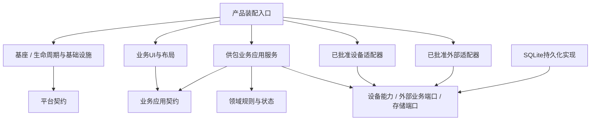
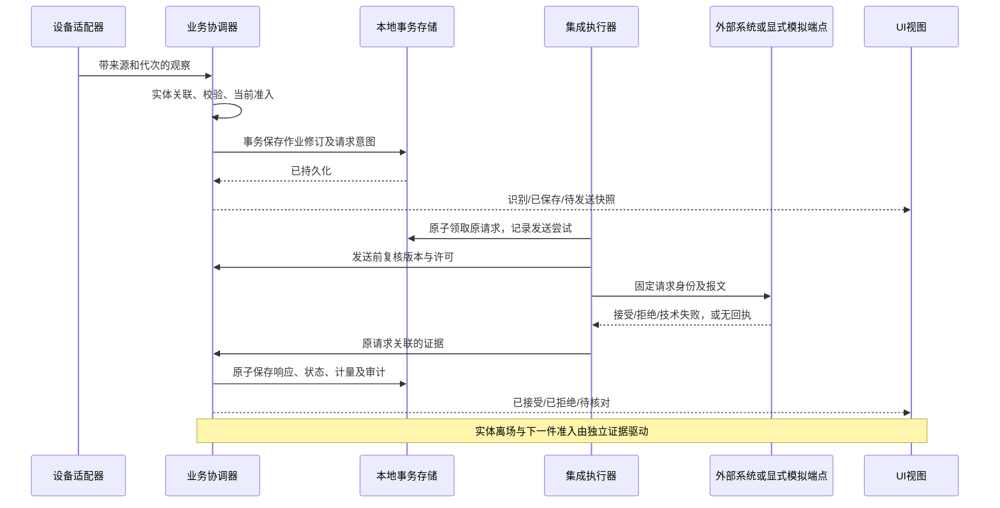

> 当前设计阅读顺序：[框架F决策](framework-decisions.md)与19/20职责可靠性 → [22独立Application拓扑](application-architecture-22.md) → [质量/恢复](architecture-quality-closure-01.md) → [RCS](sportmaster-rcs-task.md)与[版本兼容](version-compatibility-01.md)。[并发整合报告](../runtime/parallel-task-reconciliation-01.md)记录差额、来源和验证，不替代原D/RV或降低目标。当前业务1.2.3、Contracts1.7.0、Parcel DB6；下文历次版本/阶段说明保持形成时语境，历史原件见归档。Windows实际NOT_RUN，真实设备/协议/现场BLOCKED。

# 从CLOSURE-13继承的职责与决定

职责映射见[受控装配与扩展](controlled-extensions.md)，实现/验证入口为[13报告](../runtime/arch-extension-closure-13.md)。基座负责机制，业务及其公共契约拥有状态/规则/数据/页面，设备拥有采集，集成拥有外部协议，Product和构建选装根可引用具体实现。Ipc.Assembly通用路径不解释Supply/left-right/loopback；编译注册选择一个业务及所属views/layouts，UI复用业务应用契约。

F-03/F-04：Supply与功能完整的Inspection参考业务实际装配，旧专用ProductHost保留，非任意业务热插。F-05/F-06：两类受信扩展分别使用设备身份/业务角色与服务实例/目标端口；实际AssemblyRef、精确依赖闭包及运行解析同一政策，ID/version跨退休不可变。F-09/F-10：原StationConfig唯一部署修订，新请求T1冻结实际集成包/参数/合同/目标；历史核对原身份，缺能力明确阻断，不默认重发。公共契约无DB/UI/根容器。

13实施时Mac开发与WPF交叉构建获用户授权；Windows实际验收统一延期，WINDOWS_NOT_RUN，不开通VM/runner或扩OAuth。D/RV和12历史验收不倒写。下文保留原设计/历次实施的形成时语境；旧“当前/下一阶段”不取代本节。

# 供包工位框架架构与模块设计

> 先前纠偏入口（历史）：[AUDIT-RECONCILIATION-01](../work-packages/WP-IPC-AUDIT-RECONCILIATION-01.md)。目标设计和下文历史实施/不测试记录保持形成时含义；当前08/10/09实施及验证以该包的同版报告为准。原字节已归档，D/RV不变。

03形成时独立复核：[MAIN-REVIEW-03](../reviews/main-static-review-03.md)，基准main `2579392`（PR #6/#7已合并）。8项指定整改路径静态补齐，E-06/E-10仍有工程缺口；全部运行NOT_RUN，Windows06/真实集成05分别保持NOT_RUN/BLOCKED。后续见工程增量08、参考验证09；下文07/更早记录保留形成时范围。

07形成时实施补充：[ENGINEERING-CLOSURE-07](../runtime/engineering-closure-07.md) 已完成10项工程源码整改（源提交493416f），Storage3显式升级、固定Windows账户/机级租约及UI路径以该记录为准。本轮按用户要求不测试，编译/运行/Windows为NOT_RUN、真实能力为BLOCKED；以下原记录保留形成时范围。

文档：IPC-FRAMEWORK-01 v1.0；整理日期：2026-10-16。分析基准：`39747a8c35b748da71bf9acfd56a9c9812b199b4`。

**本文保留设计形成时的目标定义；RUNTIME-03已加入独立参考实现，当前文件映射与验证见[实施记录](../runtime/implementation.md)及[交付报告](../runtime/delivery.md)。不是客户规则批准、原工程迁移批准或现场放行。** 设计形成时仓库只有资料与归档校验工具。讨论依据、方案取舍及外部事实见 [决策记录](framework-decisions.md)；当前07增量及未验证边界见上方07记录，上一包实施与验收见 [ARCH-UI-ALIGNMENT-01](../work-packages/WP-IPC-ARCH-UI-ALIGNMENT-01.md)；历史实施范围与验收以 [WP-IPC-RUNTIME-03](../work-packages/WP-IPC-RUNTIME-03.md) 为准。D 系列仍由 [决策确认包](../readiness/decision-pack.md) 管理，RV 状态仍以 [评审状态](../reviews/STATUS.md) 为准。

## 1. 推荐方案及适用边界

以下段落形成时工程阶段：PR #6已合并至main `2579392`；03复核确认E-06/E-10尚有剩余工程缺口。后续08/09、Windows06/集成05分别推进，目标架构与历史D/RV结论不变。

采用**单工位模块化单体、显式产品装配、一个业务运行实例、多视图共享、设备/集成端口隔离、本地事务与受控恢复**。基座提供运行机制，不判断拆包、发车、换箱；业务模块决定流程；UI只读状态并发起应用命令；适配器只转换边界协议。默认不引入微服务、分布式消息中间件、万能事件总线、插件市场或工作流引擎。

保留用户的四类模块，但增加“公共契约”和“产品装配定义”两个横向约束，而非两个新服务。一个业务模块可同时包含不同职责页面，也可提供同一工作台的不同布局；两者不是同一概念。

当前供包能力以既有公开问题登记和获授权资料核对：设备观察、箱/作业上下文、任务与数量、提交和关闭、报警追溯。称重、PLC直控、其他调度系统、传图仅预留扩展边界，不成为本轮必须实现的品牌/协议。没有图片留存需要，不建设图片管线。通用框架不规定所有产品都使用双相机、共享箱或某种数量策略。

### 1.1 新参考产品的明确技术建议

若执行时仍无获授权的既有 C# 工程，下一工作包采用 **C#、.NET 10 LTS、WPF、Generic Host、Microsoft.Data.Sqlite/SQLite、本机 win-x64** 建立独立参考运行产品。核心与模拟测试不依赖 WPF；桌面层单独 Windows 目标。实施时核验并锁定实际 SDK、NuGet 与目标 Windows 版本，记录依赖来源。这里选择的是新参考产品技术路线，**不认定旧现场工程已兼容，也不决定旧工程必须迁移**。

若取得既有工程，先读其启动、依赖、数据结构和部署，再继承合理实现；与本路线冲突时补一条有证据的 ADR，不擅自覆盖旧库/协议，也不能因局部 SDK 不兼容而改写整个业务。WPF 只运行在 Windows；Generic Host 提供生命周期/DI/配置/日志，不提供业务状态恢复。[官方依据见决策记录 REF-01～03](framework-decisions.md#外部技术依据)。

## 2. 边界、所有权与依赖

|部分|拥有的责任|禁止进入的责任|
|---|---|---|
|产品装配入口|本产品业务、UI、驱动、适配器的确定组合；启动绑定|不实现数量或实体动作规则|
|基座运行层|生命周期、配置校验、模块目录、存储设施、日志、诊断、资源配额|不按客户/厂商分支编排供包业务；不自动修改业务状态|
|业务领域与应用层|作业身份、状态、命令守卫、流程、事务、外部能力语义|不引用 WPF、原生 SDK 类型、具体报文路径|
|业务 UI|页面、ViewModel、输入草稿、布局、可访问性；显示应用投影|不持有设备连接；不直连数据库/WCS；不决定成功或新作业身份|
|设备驱动|枚举/绑定/连接/采集、原生资源、观察转换、健康状态|不按条码猜测实体去重；不累计业务接受量、不自行发车|
|集成适配器|协议序列化、认证、响应分类、事件翻译、真实能力声明|不决定客户端应跳过校验/盲目重试；不回调具体页面|
|持久化实现|按业务端口完成原子写入、读取、迁移、备份|不允许任意模块跨表直接改状态|
|契约|平台/设备能力/业务应用边界的数据与接口|不成为包含所有业务对象的全局 Common 大包|

箭头表示编译依赖，不表示硬件控制流；Ports 是逻辑分组，可按所有权放在平台或业务契约程序集。业务专有的外部端口由业务拥有，通用设备能力由平台契约拥有。装配入口可以依赖具体实现，运行中的业务/页面不得通过 service locator 任意取出驱动。逻辑责任不强制一责任一项目；依赖检查必须保证无反向引用、无循环。

## 3. 选择时机、产品组合与版本

|阶段|允许选择|不能做|
|---|---|---|
|编译期|实现契约、业务策略代码、UI、驱动与适配器；共享契约版本|把每个客户差异写进基座；以字符串反射替代所有接口|
|打包期|选定一个业务实现、允许的页面/布局、所需驱动与备选实现、运行模式和 RID|带入全部未知 DLL；把客户秘密放入发布清单|
|启动期|校验产品清单；将设备实例绑定业务角色；选择已包含的布局与端点配置|配置中指定未批准程序集；缺模块时悄悄启用模拟|
|运行期|页面导航、展示偏好；提交有校验和生效条件的维护草稿|热换业务模块/SDK；按新地址重投旧积压；用恢复按钮清除全部阻断|

业务服务与其UI共同版本交付，但生命周期解耦。更换业务产品属于发布/迁移操作，不是操作员菜单项。插件依赖以批准的产品组合锁定，不承诺任意版本自由组合。

### 3.1 装配清单与配置结构

以下是**应用内部建议结构**，不是既有文件格式、厂商 SDK 或 WCS 报文。实现可调整名称，不得丢失语义。

|记录|关键字段与约束|
|---|---|
|ProductManifest|schemaVersion、productId、businessModuleId/version、runtime/RID、allowedModules、allowedViews、mode；均必填，发布包不可由普通运行账户修改|
|ModuleDescriptor|moduleId、kind、version、contractMajor、capabilities、dependencies、loadMode、entry、relativeFiles及校验值；ID唯一、依赖无环、路径受限|
|DeviceBinding|bindingId、role、driverModuleId、stableDeviceId、配置版本、参数；驱动实现/设备实例/业务角色分别标识|
|IntegrationBinding|bindingId、adapterId、contractVersion、targetIdentity、端点配置版本、credentialReference、能力声明；不存明文凭据|
|StationConfig|stationId、版本、设备及集成绑定、容量、许可策略引用、身份配置；未知字段按版本规则拒绝，不随意忽略|
|PresentationSettings|viewId/layoutId、列宽及用户偏好；不包含数量规则、通道实体映射或发车许可|
|ConfigRevision|revisionId、原版本、差异、操作者、验证结果、状态与生效时间；未生效配置不能伪装为当前配置|

清单校验值只有在清单本身来自可信发布渠道且目录有访问控制时才有防篡改意义；自带哈希不能自行证明发布者身份。首版采用明确注册工厂和允许名单；允许声明受控插件模式，但不要求所有模块动态加载。所有模式均须检查契约主版本、依赖、路径、文件身份及运行架构。

### 3.2 DELIVERY-12 受控后装增量

F-04/F-06/F-10以本次[决策表](framework-decisions.md)及[受控扩展设计](controlled-extensions.md)为当前增量：构建组合锁定核心和可选分发模块；离线签名包经独立信任、兼容、路径、配额和文件校验后只安装登记；包/模块/实例/设备/业务角色分开。精确包集合、schema参数和绑定统一进入原配置修订，二进制增删升级默认受控重启。不可关闭的核心安全/管理/恢复继续在宿主；不扫描任意DLL、不把ALC当沙箱，不以安装代替激活或业务放行。以下原分层、单业务实例、端口、事务、Unknown、资源和真实能力边界继续有效；本次前版本字节已归档。

## 4. 驱动与外部适配器

### 4.1 按能力设计，而非万能设备接口

统一生命周期和健康描述；采图、读码、称重、PLC点位访问是不同能力。图像帧不等于识别结果；需SDK资料确认设备直接读码还是采图后解码。SDK型号/函数/结构体/错误码尚无依据，不在本文编造。

读码能力向业务提供不可变观察：deviceInstanceId、connectionEpoch、observationId、可选triggerReference、observedAt/receivedAt、来源序号、码集合、质量状态、编码及必要元数据。有码/无码/多码/非法格式是观察结果，不是供包成功。业务拒绝不得伪装为设备故障。

硬件原始内存生命周期由适配器掌握：在SDK允许期限内复制或取得合法所有权，回调委托/句柄存活覆盖注册周期；停止时先关闭新回调入口、取消注册、等待在途回调释放，再销毁缓冲区和设备。无法确认可安全中断的原生调用，不使用任意杀线程或释放仍在使用的内存。

回调只做必要接管、来源标记和入有界队列；不等待WCS、不更新控件、不做长事务。UI刷新可以合并，业务观察不能为维持帧率静默丢弃。相同条码不是驱动级重复证据；可证明相同SDK通知身份的重复才可抑制，并保留计数/追踪。

### 4.2 部署与隔离

推荐“**按需随产品打包，安装后按适配器/版本/RID独立存放，启动时受控选择，首版不热卸载**”。例如 `plugins/drivers/<id>/<version>/native/<rid>/`；集成适配器与业务扩展代码分目录。目录只是组织方式，加载器还须明确路径、依赖解析和共享契约身份。

对现代.NET的受控插件可用 AssemblyLoadContext 与 AssemblyDependencyResolver；契约程序集由宿主共享，不在不同上下文各装一份。它们不是安全或崩溃隔离边界。Windows DLL搜索采用明确路径及受限规则，不靠修改全局 PATH、工作目录或混放 libs 解决冲突。[REF-04/05](framework-decisions.md#外部技术依据)

默认单主体进程。只有出现位数不兼容、不可共存的原生依赖、无法恢复的SDK阻塞/崩溃，或独立重启需求证据时，才引入受监督设备子进程。x86 DLL不能直接由x64进程加载；跨进程端口必须包含协议版本、进程代次、请求关联、心跳/失联、消息上限及有界接收，不能传裸指针。子进程重启使原许可失效，不自动恢复实体动作。[REF-06](framework-decisions.md#外部技术依据)

### 4.3 外部系统端口

WCS/RCS/DCS及传图称为“集成适配器”，不共用万能 Send(json)。业务定义需要的逻辑能力，适配器映射实际合同。验箱、校验、提交、查询、关闭只是逻辑目的；**不据此强制对端存在相同数量接口，更不能把一个有副作用接口调用两次**。

每种操作声明：effectClass、requestIdentityScope、支持的结果查询、幂等语义/有效期、顺序约束、权威响应解释、技术失败证据。没有合同证据时，不声明支持幂等、结果查询或自动重发。通用HTTP连接恢复不等于带副作用业务可重试。

## 5. 生命周期、并发与背压

### 5.1 生命周期

启动顺序：最小诊断可用 → 产品与配置校验 → 进程/站点控制权 → 数据库健康与迁移 → 恢复未决任务并设置阻断 → 按依赖初始化模块 → 建立连接与自检 → 计算业务准入。UI可先显示启动进度，但不能把模块加载成功当作允许开工。

模块状态至少包括 Registered、Initializing、Ready、Stopping、Stopped、Faulted；设备状态另含 Connecting、Disconnected、Reconnecting、Unknown。初始化部分失败必须按逆序释放已取得资源。缺少必需模块时只开放诊断；可选模块失败的影响由业务能力依赖决定，不凭“可选”跳过必需流程。

停止顺序：拒绝新入场/新高风险命令 → 固化关闭屏障 → 排空已接收事件或记录无法处理事实 → 在界限内等待在途结果并保存不明状态 → 取消后台任务 → 逆序停采集/断连接/释放 → 关闭存储。退出期限是资源管理界限，不可因此把已发送请求改成失败。每个后台任务均有所有者、取消来源和异常观察者。

页面关闭只释放页面订阅；切布局不重建业务单例。首版选择桌面进程拥有运行核心，退出客户端即受控停止，不承诺关UI继续生产。需要后台独立运行时另立ADR，不让Windows Service隐藏出现。

### 5.2 执行模型

每工位一个应用协调器，串行裁决共享箱与相关通道的状态转换；设备回调与网络I/O独立异步进行。数据库写入短事务、单写入调度；网络等待期间不占事务或全局锁。多UI命令通过同一入口，以commandId和expectedRevision防重与检测过期操作。

设备数据队列、应用命令队列、发送队列均有容量。默认不丢入队后的业务事件；队列满时立即形成 Overload 阻断、来源/数量诊断及受控恢复要求。SDK不能暂停时仍需明确哪些观察未被接纳、保留受影响实体待核对，不能声称每个回调必然持久化。健康/停止/严重故障有独立受限优先通道或预留容量，避免满队列导致“停止也排不进去”。

UI使用带revision的只读快照和增量通知；慢页面可跳过中间展示版本，但重订阅先取当前快照，不丢业务事实。为异步事件标识来源序号/连接代次；不依赖墙钟时间判断唯一身份，超时用单调计时，时间戳用于审计。

## 6. 业务身份、状态与端到端链路

### 6.1 不可合并的身份

|身份|语义/规则|
|---|---|
|Observation|一次设备读码观察；一个触发可能多次观察，观察也可能不产生作业|
|Admission|实体准入证据；来源由D-05/06确认，模拟场景显式生成，不能用时间窗猜|
|Session|工位上的箱/业务会话；切页面不改变，未经关闭确认不换箱|
|Operation|一次供包作业；同码新实体建立新ID；受控纠错记录修订与旧事实|
|BusinessRequest|一次特定业务意图；固定payloadHash、targetBinding、contractVersion、operationRevision|
|SendAttempt|一次网络尝试；请求身份不变、attemptId不同，不能新增计件|
|AcceptanceFact|权威业务接受的计量事实；唯一来源约束，重复回执不重复入账|

不能仅由相机数量决定实体数量。共享箱/两逻辑通道是参考产品的显式模型，不代替现场相机—实体位—AGV映射批准。没有可靠Admission或来源冲突时进入待关联/阻断，不错误绑定当前焦点页面。

### 6.2 状态与准入

|状态域|关键状态|不可变规则|
|---|---|---|
|会话|AwaitingContext、Validating、Active、ClosingCheck、AwaitingShortageDecision、Closing、CloseUnknown、Closed|Closing建立两通道屏障；CloseUnknown保持箱身份，不能清空换箱|
|作业|Observed、ValidationPending、ValidationRejected、AwaitingAction、SplitRequired、SubmitPending、Accepted、Rejected、OutcomeUnknown、AwaitingDisposition、Finished|Accepted是业务结果；实体占位另存，不能据此证明离站|
|请求|Prepared、Dispatching、Accepted、Rejected、Unknown、CancelledBeforeDispatch|Dispatching崩溃恢复默认Unknown；技术结果不明不改成Rejected|
|实体占位|Unknown、Occupied、AwaitingReset、Clear|Clear必须来自批准事件或明确模拟证据；业务接受不能自行转换成Clear|
|身份会话|Unauthenticated、Authenticated、Locked/Expired、SignedOut|权限与操作者快照随命令保存；换人不覆盖旧请求责任|

上述是建议状态契约，具体枚举可合理整合，但必须分别表达这些事实，所有合法/未知值有安全投影。状态进入/退出由事件、版本和事务支撑，不是设置一段提示文字。

使用 `BlockReason(code, scope, source, sourceEpoch, evidenceVersion, expiresAt, clearAuthority)` 集合而非一个可写gate。设备、存储、身份、WCS、业务未决、配置变更、实体许可、人工暂停分别记录。CanAdmit、CanSubmit、CanClose分别计算；关闭并不机械要求所有采集设备在线，但必须满足其真实业务依赖、在途屏障和存储/外部契约。

ResumeAdmission只解除OperatorPaused，不能解除其他原因；在命令执行和真正发送前再次核对当前作业版本、绑定、许可及有效期。准入变化与UI一致，但UI按钮禁用不是安全边界。软件暂停不是安全急停。真实动作最终执行者的联锁仍由设备/调度合同决定。

### 6.3 核心流程

同箱连续流程不能要求重置场景：接受后保留结果，等待对应实体离场/复位再建立新Operation；拒绝后保留拒绝事实，按批准处置规则重扫或进入新实体。未提交草稿只有在无已发生副作用或预留已被确认释放时才允许取消。旧回执更新旧请求/历史作业，不刷入新箱或当前通道；人工处置与自动结果CAS冲突时显示冲突待核对，不采用最后写入胜出。

### 6.4 应用契约的最小语义集合

这是目标应用契约，不是现有API或对端地址。所有改变状态的命令带commandId、对象ID、expectedRevision；操作者及权限从可信会话解析，不相信UI传来的任意角色。返回CommandReceipt应区分RejectedByGuard、Conflict、Persisted/Pending及对应对象/请求ID；Persisted不表示WCS接受。重复同commandId且内容一致返回原结果，内容不同拒绝。

|命令/查询|输入与前置条件|输出与副作用边界|
|---|---|---|
|ValidateContext|原始箱码/来源、当前工位；无其他未关闭箱|创建校验意图；仅权威对应回执可设Active|
|ReceiveObservation（内部）|设备观察与来源代次；匹配有效实体准入|保存观察/关联/草稿或异常；不据回调次数累计数量|
|SubmitOperation|operationId/revision、确认依据；任务/数量/实体及依赖许可有效|事务生成唯一提交意图；重复点击不生成新请求|
|ConfirmDisposition|operationId、处置类型及权威证据；无未处置副作用|退出旧实体占位，允许下一准入；不能只清结果|
|PauseAdmission / ResumeAdmission|scope及原因；恢复需对应解除权限|只改变相应阻断；不取消已交给网络的请求|
|CheckClose / ConfirmShortageClose|sessionId/revision；后者绑定检查快照ID及确认|建立关闭屏障、创建关闭意图；确认框不直接清箱|
|ReconcileRequest|requestId、证据、预期版本及处理权限|追加核对记录；一致时事务收敛，冲突时继续阻断；无证据不得强制成功|
|SaveConfig / ActivateConfig|原配置版本、差异；激活需维护条件|草稿与有效版本分开；不得重定向旧请求|
|GetSnapshot / Subscribe|工位、订阅版本|只读快照/变化；断档重新取快照，不重启业务|
|QueryHistory / GetRequestDetail|时间、对象、状态、分页；权限检查|历史事实及各Attempt/回执；不从当前视图拼旧记录|

设备端口表达Initialize/Connect/Start/Stop/Disconnect/Dispose及Observation/Health事件；集成端口表达带固定身份的业务意图执行、受支持的查询与外部事实。某个真实合同把多个逻辑阶段合成一次请求时，适配映射必须说明副作用，不机械地把上表每行翻译成一次HTTP调用。

## 7. 事务、可靠发送与恢复

**事务T1**：作业修订、输入证据引用、请求不可变报文/绑定、审计、Outbox意图共同提交；失败则不发送。**T2**：原子领取，创建Attempt并把请求设为Dispatching。网络调用在事务之外。**T3**：保存回执及来源、请求/作业状态、唯一接受账和审计；只更新匹配版本的当前投影。

领取之后、实际交给网络之前发生崩溃，也可能无法确定未发送；保守恢复为Unknown。只有持久证据证明未交付网络，或真实合同明确支持原身份幂等且许可仍有效时，才允许原请求再次发送。重试不更换业务身份/报文/目标绑定。业务拒绝先处理原因，不能原样无限重试；修改意图建立新请求并关联旧拒绝。

|故障窗口|恢复语义|
|---|---|
|T1之前/事务回滚|无可发送意图；不显示业务成功，处理来源观察是否需要人工复核|
|Prepared未领取|可恢复待发送，但先复核许可、合同版本与目标，不默认为允许离线继续放货|
|Dispatching中断/回执丢失|Unknown；禁止创建同意图新请求规避核对|
|远端接受但T3写入失败|全站存储阻断；可显示“已收到接受回执，保存失败，需核对”，不计作已可靠落账、不自动重发|
|迟到/重复/冲突回执|原请求去重、保留证据；旧作业只更新历史，矛盾结果保持待核对|
|备份恢复落后于真实外部状态|恢复隔离模式先核对，不把旧Prepared当新任务自动补发|

查询结果“查不到”不自动证明未处理；核对需考虑权威范围、保留期和身份。没有查询能力时提供请求专属证据导出与批准人工SOP，不能提供无证据“标记成功”。关闭请求有独立requestId、少货检查快照、强制/正常类型、操作者及回执，CloseUnknown不能打开泛化错误框了事。

离线可接纳多少业务及是否允许实体继续是D-07，不在平台默认放开。本地可靠保存提高恢复能力，不构成端到端恰好一次保证。

## 8. 本地数据与持久化约束

新参考产品使用本机SQLite。建议WAL、外键启用、完整提交持久性配置、短事务与受控checkpoint；实际PRAGMA、busy超时、上限须写入配置与验证记录。WAL允许读写协作但仍单写者，不放网络共享目录；备份使用一致性备份机制，不只复制运行中的主库文件。[REF-07/08](framework-decisions.md#外部技术依据)

下表是开发所需逻辑字典；名字可变，唯一性/关联/历史保真不能省略。主键为不透明文本ID，版本为递增整数；条码始终字符串。时间存UTC并保留源时区/时间证据，不用仅时分秒作唯一键。

|实体|必要数据与约束|
|---|---|
|StationSession|id、stationId、contextRef、state、revision、openedAt、closedAt?、operatorSnapshot；同工位仅一个有效会话|
|DeviceObservation|id、deviceId、connectionEpoch、sourceEventId?、receivedAt、codes/quality、关联operationId?、处置；有来源ID时组合唯一|
|SupplyOperation|id、sessionId、laneRole、admissionRef、revision、barcode、任务/数量快照、result、occupancy；不同实体同条码允许多行|
|OperationEvent|eventId、operationId、revision、kind、证据、causationId、timestamp；追加记录，非全局事件溯源平台|
|BusinessRequest|id、ownerType/id、operationRevision?、kind、semanticIntentKey、payload/payloadHash、bindingRevision、contractVersion、state；语义意图唯一|
|OutboxDelivery|requestId唯一外键、调度状态、nextAttemptAt?、claimedBy/epoch、claimAt；与请求同库事务|
|SendAttempt|attemptId、requestId、ordinal、startedAt、transportDisposition、endedAt?、errorClassification；(requestId,ordinal)唯一|
|ResponseEvidence|evidenceId、requestId、sourceIdentity、result、receivedAt、原报文摘要/受限内容引用、payloadHash；来源身份去重，冲突不覆盖|
|AcceptanceLedger|acceptanceId、requestId、operationId、quantity、unit、证据引用；来源接受身份及本业务计量目的唯一|
|AlarmOccurrence|id、source、sourceEpoch、code、scope、ownerRef?、raisedAt、ackedBy/At?、clearedAt?；已读不等于恢复|
|ConfigRevision|id、kind、baseVersion、内容/摘要、state、actor、validatedAt、activatedAt?；绑定与旧请求历史保留|
|AuditAndReconciliation|id、actorSnapshot、commandId、对象/旧新版本、reason、authorityEvidence、结果、时间；人工与自动均可追溯|
|SchemaHistory|migrationId唯一、checksum、appliedAt、productVersion；历史迁移不可覆写|

索引至少覆盖请求(state,nextAttemptAt)、作业(session,lane,time)、观察(device,epoch,sourceEventId)、报警(active,scope,time)、审计(owner,time)。业务字段由业务模块拥有；共享一个库不等于跨模块直接写表。

接受数量按唯一业务事实累计，不按回调、按钮或Attempt计数。零、未知与缺失数量分别表达；真实数量单位/规则仍等待D-03/04。历史查询直接读取历史快照，不从当前通道拼接旧记录。

数据清理仅处理终态且超过批准保留期的记录；任何未决、关闭不明、引用中的证据/配置不得先删。建议容量预算单独覆盖DB/WAL、日志和导出，不凭全场日产能推算单站峰值。磁盘低水位报警；写失败阻断相应关键操作；损坏库不能用空库替换后绿灯运行。

## 9. 配置变更、身份与诊断

配置状态为Draft→Validated→PendingActivation→Effective，失败进入Rejected/ActivationFailed并保留旧有效版本。保存草稿不等于立即生效。展示设置可即时应用；设备参数/驱动/通道映射/外部目标/身份规则需要维护权限、无冲突任务及受控停止，首版必要时重启生效。

旧请求永远绑定原targetIdentity、合同和配置修订。维护人员修改地址不得自动迁移Outbox；原目标不可访问时保留请求待核对。驱动切换增加connectionEpoch，旧连接回调不能进入新绑定。只测试连接默认不写PLC、不触发设备动作。变更全过程显示差异、影响、执行中、失败原因与回滚结果，避免页面刷新清除草稿。

身份认证使用适配端口，业务命令校验角色与有效身份。操作员日常导航不授予配置权；维护身份不能自动获得强制放行权。跳过登录是产品批准配置，不是系统匿名万能管理员。模拟身份提供固定角色夹具并明确标识；生产认证/换班规则缺失时阻断相应操作，不返回模拟登录成功。

结构化日志带station/session/operation/request/attempt/module/binding/trace标识，级别和频率可控；日志不代替业务账。健康快照含来源、更新时间、连接代次及失效原因。诊断包按用户选择时间/对象导出，包含版本、脱敏配置、状态、关联事件与必要日志，去除秘密及超范围数据；敏感报文默认不写普通日志。故障持续可见，报警已读和清除按独立事件身份保存。

## 10. 多UI与专业操作界面约束

供包业务实例对UI提供：执行类型化命令、查询历史、获取当前快照、订阅带版本的投影。ViewModel拥有自己的输入草稿/筛选/焦点/滚动，但不复制一套业务流程。页面离开只解除展示订阅；重新打开先获取快照。相机来源与键盘焦点无关。

首个参考产品包含主工作台、记录及请求详情、报警/核对、设备/配置诊断；标准与紧凑工作台是同一业务的两种布局参数，不切换业务实例。全局设备和阻断状态在抽屉/详情打开时仍可发现。主屏保留上下文→通道结果/条码/数量→下一步动作→最近记录的层级，不加入无用统计大屏。

|组件/动作|交接约束|
|---|---|
|健康状态|Connected、Reconnecting、Faulted、Unknown与过期均可显示；不保留失效绿色|
|作业结果|已识别、已保存、待发送、处理中、WCS已接受、WCS已拒绝、结果待核对分别表示；实体完成仅在有证据时出现|
|主操作|位置固定；执行时锁定同一意图；命令入口重检；失败给原因、影响和下一步，不统一“重试”|
|拆包|条码/SKU、保留/移除、有效扫描进度、受控清空和确认在当前任务区可见；模拟策略不冒充客户规则|
|记录详情|Operation→Request→Attempt及Response/Audit分层；关闭请求也有专属详情|
|弹窗|仅真正需要确认时阻断；进入焦点、Tab圈定、取消/Esc与返回焦点明确；不能落到背景或演示控制台|
|输入草稿|回执和窗口变化不清草稿/选区/滚动；条码保留前导零、长码可完整查看；不擅加人工改码放行|
|报警|独立事件身份；多来源同时可见，关联真正对象；设备无作业关联时去诊断，不随意跳另一通道|
|说明层|操作文案回答当前动作；ADR/D编号和评审实验按钮移出生产操作层，但未批准行为仍禁用|

使用既有 [tokens](../ui/tokens/tokens.json) 作为视觉参考，不视为已验收尺寸。1920×1080为设计基准，1366×768及更小有效区域做重排，不整体缩放；1280×680只是现有候选最小值，必须按任务可读性重新验证。WPF布局使用DIP，需分别记录物理分辨率、系统缩放和有效客户区，不能把44像素自动等同现场触控合格。业务触控目标建议至少44×44 DIP、主要操作48～52 DIP；字体沿用Windows中文系统字体，不交付字体文件。

正文、条码、数量、原因和操作优先；历史可折叠，低频字段局部滚动。提示声接受/拒绝/拆包分开、低频不循环；试听/浏览器可用不等于现场听审。正常提示不持续闪烁，不要求无证据的深浅双主题。

## 11. 部署、升级、回滚与模式隔离

应用和模块安装在受控只读发布目录；配置、DB、日志、备份放按工位与模式隔离的数据目录。普通运行账户不需管理员；安装/驱动运行库由受控维护执行。凭据由Windows受保护机制引用，实施时核验账户/机器作用域和恢复方法，不散落明文配置。

用跨登录会话有效的单实例/数据锁保护同工位运行，并为设备绑定建立本机独占控制；不能声称这可替代厂商设备端控制权协议。启动第二实例只显示已有实例或诊断，不抢占在途作业。

发布产物至少包含主程序、选定模块、清单/依赖锁、配置模板、初始化/升级/备份/回滚操作入口和实际使用说明。下一工作包先交付可解压离线发布包及受控脚本，不强求在线安装平台。SDK二进制仅在分发许可到位后由安装流程补齐；缺失时报明确诊断。

升级先检查未决任务及可恢复性，暂停入场并备份一致快照，验证产物后切换。程序、模块、配置与schema成套记录。数据库不可逆升级后不能只换回旧EXE；恢复备份可能落后于外部世界，必须进入核对模式。回滚失败保持不开放业务并保留诊断，不删除原数据。

Simulation与Production使用不同装配清单、端点允许规则、数据根目录、醒目标识和身份来源。模拟端点仅loopback，报文为工程夹具；生产包不能把模拟适配器注册为缺省，也不能因连接失败退回模拟。生产必要合同/设备/规则未提供时，启动可诊断但业务拒绝准入。没有现场授权不得操作实体设备。

## 12. 设计准入与交付界限

本设计允许新参考运行产品实现平台机制和供包参考业务的可控模拟闭环；不宣称完整客户生产需求已经进入公开仓库。数量、实体、权限、合同和旧工程决策未解决，只阻塞相关生产路径。参考策略、角色、事件夹具均写明工程性质，不把模拟参数落成生产默认值。

后续通过代码、持久化与UI实际运行证明边界；原型本身不是可照抄的实现。业务外部契约与最终联锁仍需D系列证据；RV关闭分别记录新实现修订、验证范围与尚未验证部分，不能仅因目标设计已写完就关闭。下一阶段完整范围、检查和不做项见 [实施工作包](../work-packages/WP-IPC-RUNTIME-03.md)。

## 13. RUNTIME-03 当前实现映射

|责任|实现|
|---|---|
|显式装配/配置/受控生命周期|`src/Ipc.Platform/Configuration.cs`、`Lifecycle.cs`，`src/Ipc.Product/ProductRuntime.cs`|
|共享应用契约/作业/命令/许可|`src/Ipc.Application.Supply/Model.cs`、`StationApplication.cs`|
|实际SQLite事务/Outbox/接受账/备份|`src/Ipc.Application.Supply/Store.cs`|
|人工/文件源、固定绑定HTTP端口|`src/Ipc.Adapters/ObservationSources.cs`、`LoopbackIntegration.cs`|
|独立持久接收账与原子需求裁决|`src/Ipc.Fixture/Receiver.cs`、`Program.cs`|
|WPF页面/布局/焦点/草稿|`src/Ipc.Desktop/`|
|关键故障/进程重启验证|`tests/Ipc.Verification/Program.cs`|
|发布/备份/预检查/回滚|`scripts/publish.ps1`、`station.ps1`，核心CLI维护入口|

当前批准范围为新通用参考实现。数量/实体/权限策略带SIMULATION身份；Production缺必需能力拒绝业务。真实SDK、WCS、Windows桌面运行和现场放行仍分项待验。设计形成时的原始事实与外部D/RV状态不倒写。
