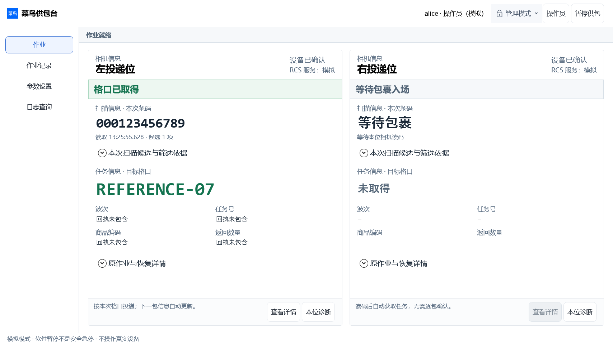
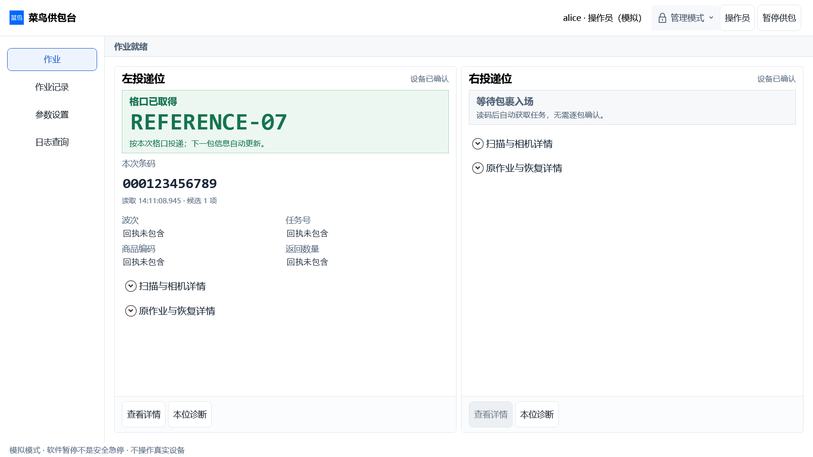
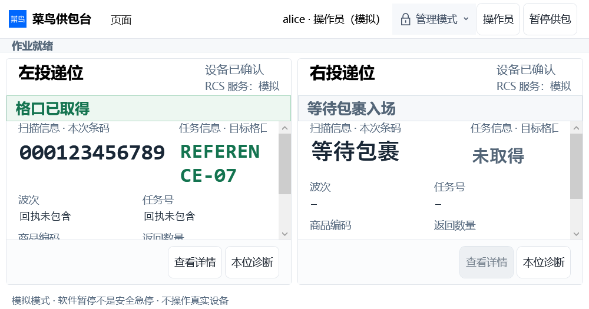
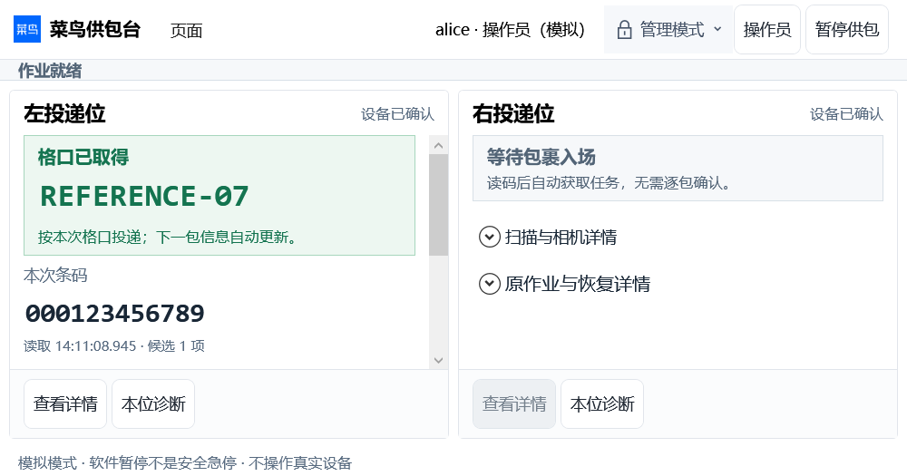
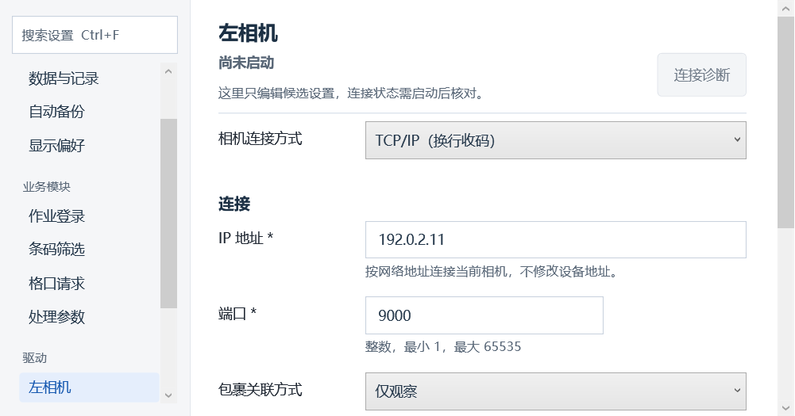
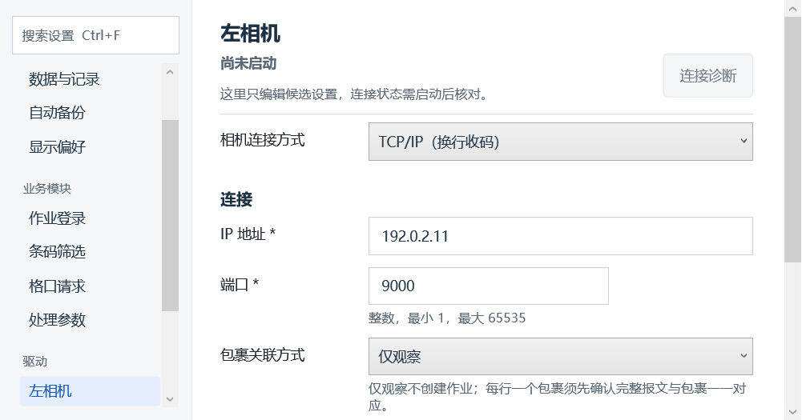
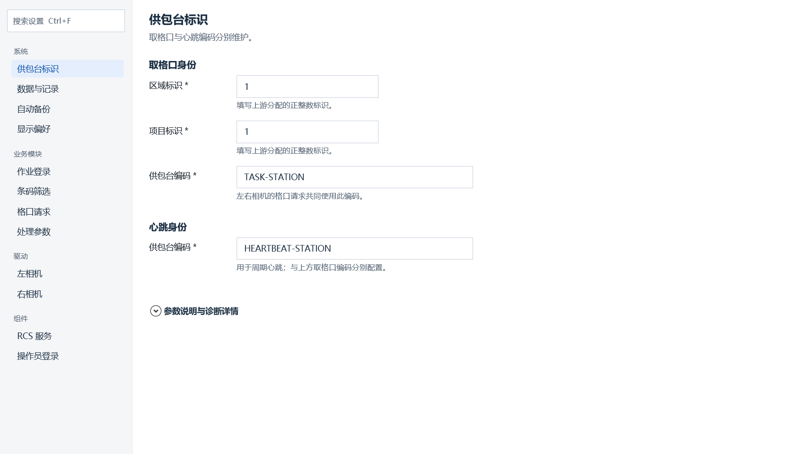
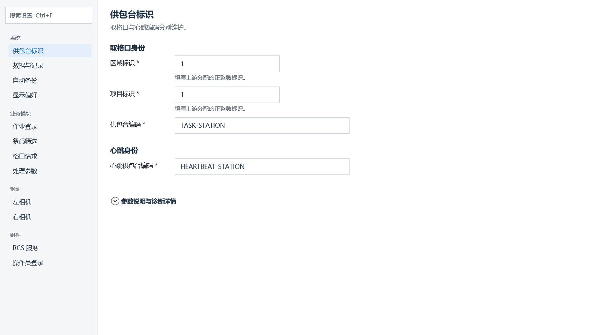
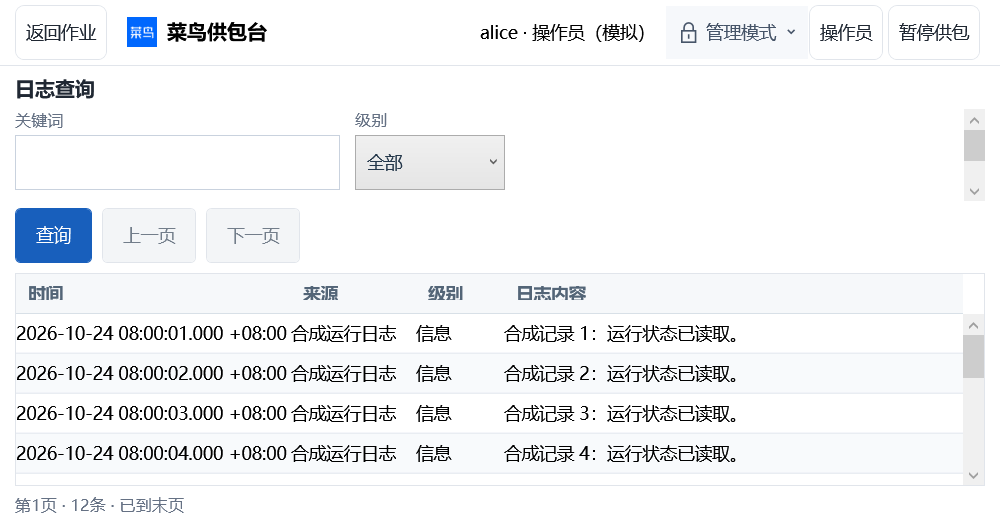
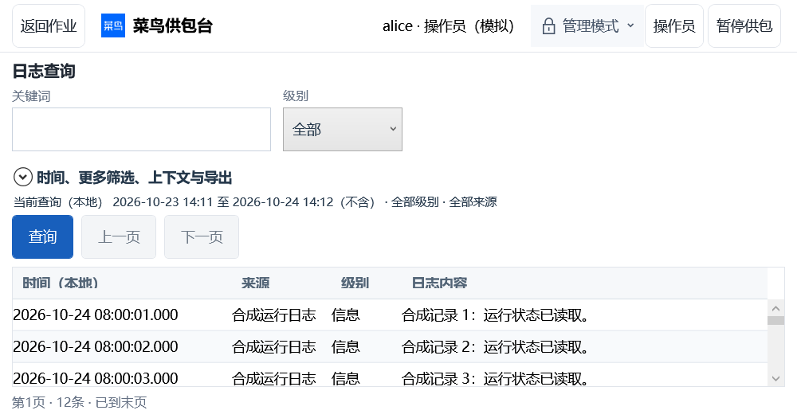

# HIERARCHY-02 原生证据

所有图片来自真实Windows WPF HWND/Dispatcher渲染；本机实际DPI 125%，合成数据和端口，不是HTML、实机双相机或现场验收。前后默认供包台使用同一合成新包裹、同窗口客户区；参数使用同一合成TCP/RCS完整候选、同一共享日常表单。

当前最终源码`1663033`及371项本机回归见[CI-FIX.json](CI-FIX.json)、[CI续修与最终截图](ci-fix/README.md)。下方`after`/RESULT保持初次`c1e7950`/`4c54d85`来源；CI发现后另行修复，未倒写这些旧图/日志。默认工作台及日志对照已指向最终采集，参数控件实现未在CI续修中更改。

baseline生产源码：`c91559f6f981a9f2c9f89bd5afc271089f0e9d8e`。最终源码与各组验证的精确提交、实际尺寸、计数见[RESULT.json](RESULT.json)，文件hash见[FILES.json](FILES.json)。图片名称尺寸是目标DIP，实际值以日志为准（1366.4×768、1092×613.6或614、800×420）；图片像素随实际125%DPI放大。

## 同场景前后

| 场景 | main之前 | 本轮之后 |
|---|---|---|
| 默认作业1366×768 |  |  |
| 默认作业最小800×420 |  |  |
| 左相机最小800×420 |  |  |
| 供包台标识1366×768 |  |  |
| 日志最小800×420 |  |  |

参数对照仅共享编辑控件，不把它扩大为整窗保存可达性；整窗保存、Pending/Effective、焦点/滚动及授权边界分别见regression中的V3与parameter-shell-polish原生结果。

## 新增异常与边界

- [Unknown](after/supply-station-Unknown-800.png)、[Rejected](after/supply-station-Rejected-800.png)、[Conflict](after/supply-station-Conflict-800.png)：一致合成事实，另一位保持空位可准入；不沿用旧只改Wcs.State的失真证据。
- [等待回执](after/supply-station-pending-800.png)、[新输入未准入](after/supply-station-unadmitted-1366.png)、[快照失效](after/supply-station-stale-1366.png)：不能把旧格口当作当前结果。
- [长字段最小尺寸](after/supply-station-long-800.png)：全文选择、焦点和轮询后滚动保持；内部滚动承担超长内容。
- [日志页连续冲突](after/supply-station-logs-command-Conflict-800.png)、[通信异常待核对](after/supply-station-logs-command-Throw-800.png)、[折叠后的范围](after/supply-station-log-range-800.png)：当前全局回执可见，更多筛选可达。
- [相机字段错误](after/parameters-right-error-800.png)：保留输入与就近错误；候选中的取格口/心跳编码分离。

日志页异常回执在800×420会压缩列表，列头不与空态叠字；底部状态仍表达尚未查询/查询关闭。恢复常用尺寸或收起已核对回执即可扩大列表，不隐藏未处理操作结果。

`before/WINDOWS-WPF.log`为原main原夹具正常场景；`before/PARAMETERS-WPF.log`由main生产源码加本轮只采集用参数夹具生成，baseline开关只适用于前图，不充当新断言PASS。`after`及`regression`均开启正式断言。未上传模拟DB、账号配置或客户原稿。

真实相机/SDK/RCS、目标IPC、物理键鼠/扫码、其他OS DPI和安装联调NOT_RUN。正式发布/安装未执行；本地publish/environment-report只证明程序入口可启动。
