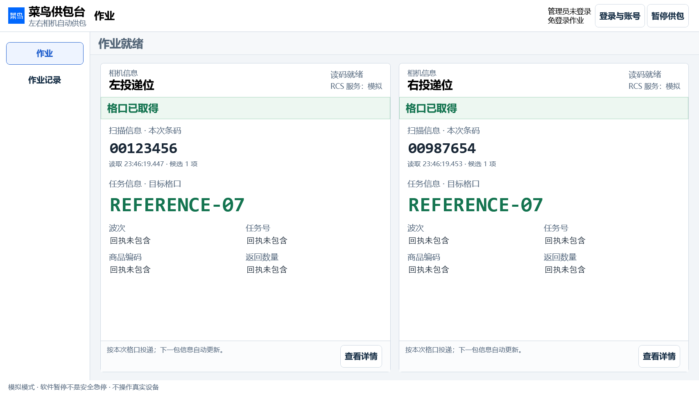
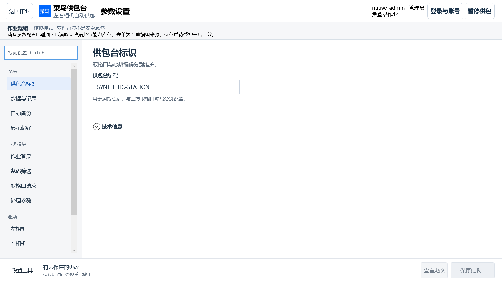
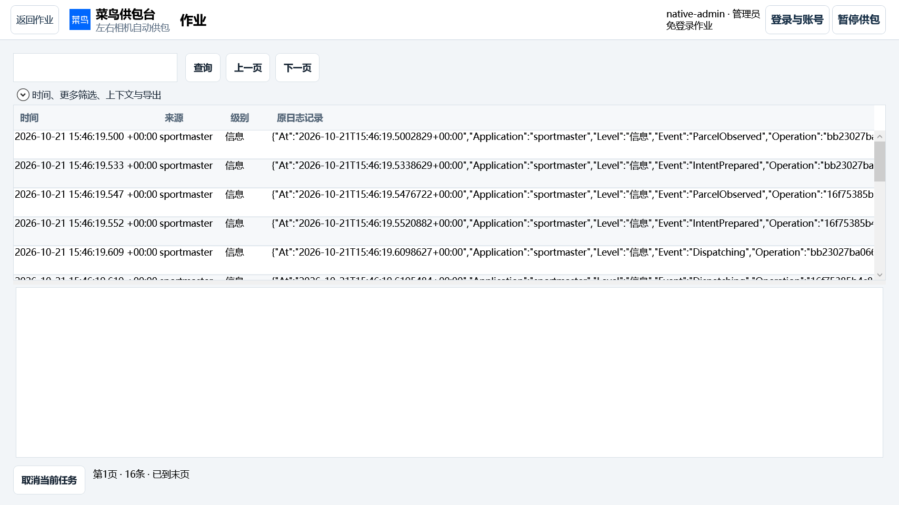
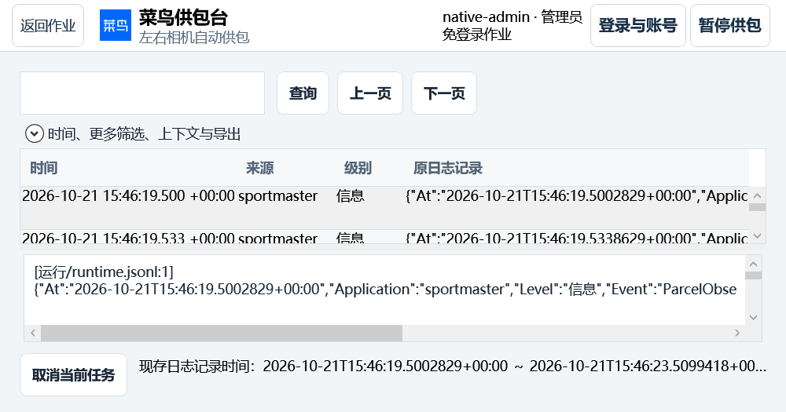
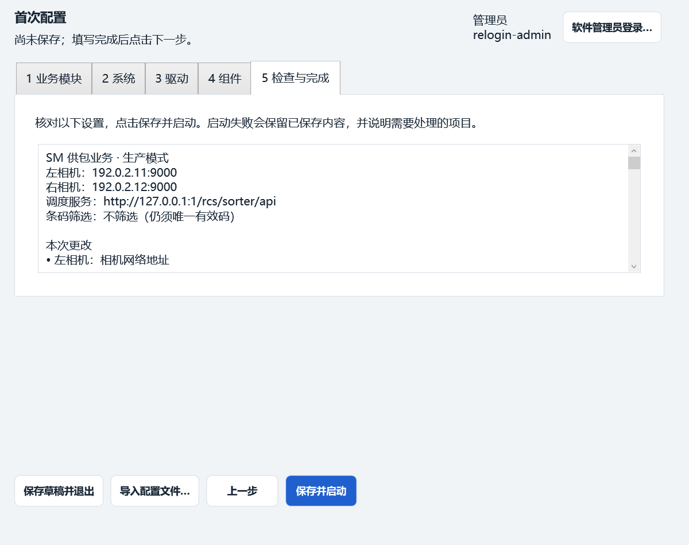

# OPS-ADMIN-LOGS-01 · 交付验证

2026-10-21，开发分支 `codex/operator-admin-logs`，[PR86](https://github.com/yuan2go/importer-pc/pull/86)。开工及最终复核 main 均为 `3b883fe6a53b58b29eeca18c3719b5bfc0ee388e`；PR82～85仍open（84/85 draft）。整合85 `d52ade7` 与84 `587fbe8`，最终核对这四个PR的head均无后续源码差异，保留原PR和历史SourceCommit。最终交付产品为Sportmaster 1.10.2 / Contracts 1.15.0 / 配置schema3 / DB8；1.9.x、1.10.0及1.10.1冻结保留中间候选身份。

功能取舍见[工作包](../../work-packages/WP-IPC-OPERATOR-ADMIN-LOGS-01.md)，实际操作和安全边界见[当前指南](../operator-administrator-logs-01.md)。删除支持摘要的契约与实现，保留独立诊断、备份恢复和原业务审计。本轮不改写历史D/RV。

## 最终交付与本机D盘迁移

推荐安装器 `CainiaoSupplyStation_SM_Setup_v1.10.2_win-x64.exe`，产品及固定原生夹具源码为 **`c9e482a30d2d1643a498e7e7ba7f12563f46f3f5`**。本机交付目录 `D:/01_工作/供包台/交付/SM1.10.2-c9e482a3/` 仅一个EXE，复制后hash一致；原构建为 `.artifacts/ops-installer-1.10.2/`，同源ZIP与库存在 `.artifacts/ops-release-1102/`。后继064030a只修正测试对缺失接管证据的异常类型，src/config无差异；收口文档不重标介质。

| 本机同源产物 | SHA-256 |
|---|---|
| 单文件安装器，178035322字节 | `8fd0afe6a053dfe1b0db7da63a7a6812a94070f8369442daf63fe141dcc3ab88` |
| win-x64 ZIP，738项库存 | `1b2f978a97d811cd30b18f3e1967a60ae94e5839331eab935fb1ef3ce2ce2064` |
| portable ZIP，112项库存 | `f8bd542dd01fccfc8a9d819f4bd6829677cbcd6ca0005bf6b06d8d96f3f3695f` |

本机冻结DLL管理员原生17项、首配93项通过，全部738项介质hash保持不变；当前截图来自该冻结DLL。CI [run78](https://github.com/yuan2go/importer-pc/actions/runs/39628940233) 全部通过，其合并测试源码为 **`c0ea40c337ba5aae2369e3e11fb96519e7985031`**，与本机冻结分别记录。真实SCM/System宿主及受限Windows令牌35条通过记录，覆盖64次管道复用、实际密码、首管批准、凭据读写/删除拒绝、锁定/撤权、一次性票据、服务缺失、同身份目录接管/重入、任意克隆及Production拒绝。CI77保留正确拒绝旧副本但夹具漏接FileNotFoundException的失败；修复没有删除拒绝断言。此前CI75/76分别保留原SourceCommit。

CI78冻结核心125条通过记录（管理员/日志55）、商业原生27、管理员原生17、参数V3 227、视觉108，发布政策、安装器同源DLL核对与受控清理检查均通过。[CI可安装产物](https://github.com/yuan2go/importer-pc/actions/runs/39628940233/artifacts/12357059360)保留至2026-11-20，SourceCommit仍为CI合并树，不替代本机产物身份。

公开归档按规范Git字节对照最新main，双方均298项历史问题，包括重复项的多重集合完全相同，本轮新增0。校验器仍为FAIL，未放宽规则；输入树及原报告hash见[1.10.2比较](../evidence/operator-administrator-logs-01/archive-comparison-1.10.2.json)。历史比较和1.9.x/1.10.1回执均保留。

用户要求的本机项目负载迁D盘已执行：74个遗留构建/验证目录、NuGet/dotnet开发缓存和5份仓库外私有原稿；1,658个原安装/配置/用户文件约485MB逐项内容及ACL核对，原件均在D盘受保护回退目录。正式程序、配置、运行数据及System认证宿主/账号根位于 `D:/ImporterPc.Deployment/`，4个快捷方式与安装登记指向D盘。首次目录数组错误、回退、MSIX路径隔离和后续修复全部保留。仅Windows系统登记/兼容入口元数据留C盘，未公开私有原稿、账号账或运行数据。

启动复核发现旧模拟来源凭证的目录仍绑定C盘。以本次c9e482冻结维护代码、经Windows授权在无包身份进程中核对原完整配置和每条原DB8记录、无作业/编号/测量责任后，先封存源，保留原ID及原密文，仅原子更新到同一物理D目录的定位。未签发新机器身份、未丢账或重发请求；生产/已有作业/任意克隆继续拒绝该入口。随后**实际已安装1.10.1（674807d）使用同一原模拟账启动并正常停止，退出0**；仅手动相机输入和reference接口，没有注入条码、连接真实设备或启动Production。此前仅安装登记的检查与这次业务启动分开记录。

当前本机正式登记仍为1.10.1。1.10.2升级已备妥并尝试请求系统授权，但没有得到升级完成回执，不宣称已安装1.10.2；交付EXE已具备完整同源验证。未创建默认管理员，用户通过“登录与账号”自行选择真实凭据开通首管。详见[D盘存储与运行](../d-drive-storage-20261021.md)和[迁移启动增量](../evidence/operator-administrator-logs-01/d-storage-origin-closure.json)。同机迁移/启动不扩张为完整安装器EXE交互、重启、双账号、换机、真实SDK/RCS或现场验收。

## 本轮工程验证

全部为本轮组合源码执行，Windows原生截图来自HWND/Dispatcher及合成端口。不是旧版本测试，也不是浏览器/HTML对WPF的替代验证。

| 验证 | 结果与范围 |
|---|---|
| 核心 `--operator-administration` | 最终CI78冻结55项PASS：真实密码哈希、首管不可覆盖、持久失败保护、退出/到期/账号撤销、一次性请求绑定helper授权、免登录管理员保护、参数保存守卫、轮转原始上下文、完整异常栈、307匹配/308时间记录全量导出、15000条流式导出与供包并发、正则超时/取消、未知防重、实际RCS无Query及Production缺保护拒绝。 |
| `--parameter-refactor` | 最终提交8917115重建夹具81项PASS，含继承的四类完整候选、下限错误定位与拒绝首样本重启后身份冲突；与本机发布src/config无差异。 |
| `--configuration-confirmation` | 41项PASS，暂停/排空、原确认身份、恢复与持久确认守卫；只对明确未准入状态有界等待，不吞异常。 |
| `--parcel-recovery-p2` | 101项PASS，持久原次Query证据、重启与原请求不重发。 |
| `--version-compatibility` | PASS，跨业务/篡改合同拒绝；原配置和Pending保留。 |
| 原生 `--operator-administration` | 本机冻结c9e482及CI78分别17项PASS、8张截图：常规/紧凑角色导航、真实账号显示、左右自动供包、完整候选跨退出保留、真实软件日志/原始异常路径与堆栈、800×420查询与取消、撤权关闭已打开页面。 |
| 原生 `--parameter-v3` / `--visual-productization` | 最终CI冻结227 / 108项PASS，四类参数、保存核对、草稿/错误/焦点、条码与格口关联、800×420～1600×900客户区；此前219/102记录保留形成时身份。 |
| 原生 `--startup-experience` | 本机冻结c9e482的93项PASS，五步完整候选、TCP/RCS静态配置、未知保存防重、首配/安装窗口及退出/到期后原候选重新登录。认证账可以创建，业务DB和设备租约不能在向导浏览时创建。 |
| 受影响Release构建 | 核心验证、原生验证、Sportmaster Desktop均0警告/0错误。 |
| Python发布检查 | commercial_delivery 5、release_documents 2、release_build 1、unified_release 15项通过。首轮缺dotnet PATH及GBK解码失败保留，配置真实SDK路径、UTF-8和D盘TEMP后重跑通过。 |

原始日志与截图见[证据目录](../evidence/operator-administrator-logs-01/README.md)。核心及原生夹具已接入同源冻结介质验证和PR Windows检查，不通过修改旧介质或扩大旧PASS实现。

## 关键页面

## 发布身份与验证边界

### 1.10.0权限边界补修

PR86发现共享数据根的凭据账可被普通Windows用户替换，1.9.x不能作为最终推荐。现由本机System认证服务保管私有凭据/锁定/会话/授权，受保护锚点阻止服务缺失时回退；软件密码登录仍允许普通Windows用户，首次开通才要求安装管理员批准。首配与运行UI只调用应用账号契约。内置RCS真实Query=false，同时修正真实连接的模拟标识；日志文件打开与轮转使用短专用锁，扫描/导出不持有，原JSON路径和完整多行堆栈分别呈现。

本机机制专项52、参数81及配置确认通过；原生管理员/日志17项和首配93项通过，包含真实登录窗口重新授权并保留原候选。实际SCM/System/受限Windows令牌测试已接入 `scripts/verify-administrator-broker.ps1` 和必需CI。本机早期普通用户在创建服务前被真实安装权限守卫拒绝，见[原失败](../evidence/operator-administrator-logs-01/broker-boundary-local-blocked.log)；该历史拒绝不算服务通过。最终CI服务验证及后来获Windows批准的本机安装/D盘迁移分别见上节，保留各自SourceCommit与范围。

### 中间候选历史

1.9.1中间候选曾补修PR83的既有P1/P2：越界测量原样本与拒绝事实同事务保存，重启后同ID改值进入原身份冲突守卫；重量下限无效/负数/精度错误定位下限并保留输入。PR82的MiB标签已有，校验文案一并统一。参数专项由75增至81项PASS。首配测试的“数据根不得存在”过期断言修正为禁止业务DB/设备租约，保留管理员元数据责任；新增重启夹具完整Dispose后再取得原资源租约，不放宽运行资源守卫。

管理员专项由44增至48项PASS：增加复制ticket后篡改请求hash、期限、单次编号均拒绝，真实会话到期日志断言。账号维护在密码计算后的提交点复核完整会话hash；helper授权在服务器端账绑定独立随机凭据，不依赖载荷自述。1.9.1随后由受保护认证候选及最终1.10.1替代；以下1.9.0证据保留其中间候选身份，不能套用为最终结果。

首轮1.9.0候选源码为 `1f4c4319cd4003ab5586b9a3fb2a23844d21310f`，由1.9.1替代。其同源portable和win-x64均构建/库存验证通过，随后安装器重建共享DLL并与嵌入介质逐字节核对通过。保留原身份，不将介质重标为新SourceCommit。

| 同源交付 | SHA-256 |
|---|---|
| `CainiaoSupplyStation_SM_Setup_v1.9.0_win-x64.exe`，177944734字节 | `2cfa62f816eb268b94cbe6a896ae099d52a9bf648260c01a8bb5b03e4d196dd7` |
| win-x64 ZIP，738项文件库存 | `78e593ddef247ee27c015acc447d9494c2ffed3880a1c4a6c5d7a4f1c39d788c` |
| portable ZIP | `e61f984b7c225a01e0e1b175f2ff5ea451551d1c700dc50d192bfeccea7e06e2` |

[发布回执](../evidence/operator-administrator-logs-01/RELEASE.json)、[安装器回执](../evidence/operator-administrator-logs-01/INSTALLER.json)、[冻结原生检查](../evidence/operator-administrator-logs-01/frozen-native-administrator.json)。同一提交的固定夹具针对实际发布DLL执行：管理员/日志原生16项及首次配置90项通过；核心管理员/日志44项通过后，完整商业恢复仍在Windows安装目录资格处失败，故[完整核心结果](../evidence/operator-administrator-logs-01/frozen-core-blocked.json)明确为FAIL/BLOCKED。738项介质文件未被夹具修改。该候选原图现保存在[1.9.0原图](../evidence/operator-administrator-logs-01/intermediate-1.9.0/README.md)，不再作为上方当前截图；早先工作树结果独立保留。

实际自包含发布EXE以 `--environment-report` 启动、取得报告并正常退出0，见[启动冒烟](../evidence/operator-administrator-logs-01/published-exe-start.json)。这覆盖EXE引导和环境报告，不冒充完整安装/设备业务启动。首轮发布因本机NuGet缓存配置与依赖许可收集器默认路径不一致失败；设置真实 `NUGET_PACKAGES=D:/DevCache/nuget/packages` 后重新完整发布通过，没有放宽许可检查。

公开归档针对main和本轮规范Git字节分别运行：同为298项历史问题，新增0。修正整合PR遗留的6项清单内容身份；未改归档校验器、忽略规则或历史问题，见[比较回执](../evidence/operator-administrator-logs-01/archive-comparison.json)。

复现使用 .NET SDK10.0.402：`dotnet run --project tests/Ipc.Application.Verification -- <仓库路径> --operator-administration`；Windows原生用 `dotnet run --project tests/Ipc.Desktop.UiVerification -- <仓库路径> --operator-administration`。发布按 `scripts/release-windows.py --profile sportmaster` 与 `scripts/package-installer.py`，实际介质参数及同源提交见回执；冻结验证用 `scripts/verify-commercial-wpf.ps1 -OperatorAdministration`，完整核心用 `scripts/verify-commercial-media.ps1`。本机TEMP/TMP改用D盘以保留规定的存储余量。

完整商业恢复在本机普通账号下被Windows部署目录权限拒绝，原失败保留；不放宽权限检查或将它记为PASS。首次错误运行的C盘空间保留守卫及无工作区参数启动错误也保留，未污染交付输入。

本机Windows 125%缩放，截图是指定DIP客户区的原生渲染，部分大客户区超过物理工作区；不声称目标工控机、物理100% DPI、触控、完整IME、双Windows账号、完整安装器EXE交互/重启验证通过。获真实UAC批准的同机迁移及同源安装升级只按上节实际范围记通过。真实SDK、客户相机实体语义、真实RCS、现场安全与验收仍未验证；RCS权威结果查询当前不支持，Production缺必需能力继续拒绝。安装器未签名，未提供签名证书；旧发行及其证据保持原身份。
