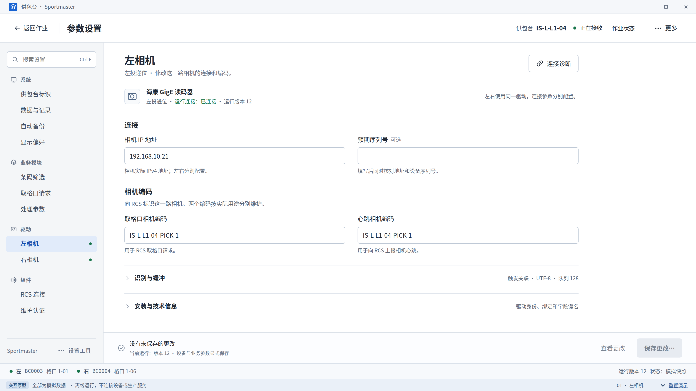

> 2026-10-22 当前权限语义以 [MANAGEMENT-MODE-01](../../work-packages/WP-IPC-MANAGEMENT-MODE-01.md) 为准：管理密码进入临时管理模式，不是管理员账号；操作员身份独立。四类参数、唯一候选、保存守卫和原业务合同继续有效。下述形成时界面与历史证据不倒写。

# 参数设置 V3 · 完整设计与开发包

**当前主推方案：同窗专注设置工作区，一个四类对象目录，一次清楚的保存审阅。** 用于替代实际参数页的重复导航、大面积技术提示和“维护与迁移”总入口。首次启动、独立Application、Sportmaster左右相机及共享RCS的业务边界保持。

[打开可交互原型](Prototype.html) · [逐张高清图集](Gallery.html) · [开发交接](HANDOFF.md) · [字段迁移表](FIELD-MIGRATION.csv) · [实际验证](QA.md) · [下一步Codex提示](CODEX-NEXT.md)

## 本轮交付与计数

- **27张PNG = 24个命名界面状态 + 3个补充尺寸**，不是27个独立页面。
- **1个可直接离线打开的Prototype.html**，包含四类目录下11个示例对象页面、保存/错误/模板对话框及作业状态演示。顶部和底部明确标注模拟数据，不连接设备或生产服务。
- **49条字段/聚合迁移记录**：包括共享投影、只读项和通用组件兜底，并非49个独立可编辑控件。已从真实schema和代码核对海康每实例6项、RCS14项及必要系统/业务参数。
- 本目录共 **54个物理文件**：27张PNG、13个可编辑源码/字体依赖文件、2个可打开HTML、5份Markdown、1份CSV、5份顶层JSON和1份构建日志。`FILES.json`登记其余53个文件，排除自身避免递归哈希。没有重复打包ZIP或把旧V1/V2文件累计进来。

本目录以外，仓库的当前索引、产品决定、工作包、实施记录与总manifest同步更新；它们不计作页面。字体许可及商业软件参考见 [REFERENCES.md](REFERENCES.md)。所有图中的值为演示值，不是生产默认。

## 直接体验关键流程

离线打开原型后：驱动 → 右相机 → 修改IP；切回左相机确认其值未改变。填写 `192.168.10.999` 后点“保存更改…”，查看原字段错误与其他输入保留；改成 `192.168.10.31`（均为示例）后进入差异审阅，按演示提示暂停、使用任意非空模拟凭证并填写原因，再确认保存。结果分别显示已保存版本13与仍运行版本12。

底部场景选择器可查看：字段错误、待生效、未知保存、保存失败、连接失败、模板预览、缺驱动、旧设置冲突，以及正常/故障作业。“重置演示”只清除原型模拟状态。正常产品不包含场景选择器。

普通返回作业会保留本窗草稿；窗口关闭按钮演示未保存内容的处理。RCS失败场景区分地址格式、目标连接与业务响应，明确没有发送真实业务请求。安全模板先预览，再仅采用允许策略到草稿。

## 逐张原始大图

除最后3张外均以1600×900逻辑尺寸导出为3200×1800PNG。点击下表可直接看原始图片，图集仅为辅助入口。

| 编号 | 页面 / 状态 | 原图像素 |
|---|---|---|
| 01 | [左相机：对象、连接与编码](screens/01-left-camera.png) | 3200×1800 |
| 02 | [系统：供包台身份](screens/02-system.png) | 3200×1800 |
| 03 | [业务模块：取格口请求](screens/03-business-request.png) | 3200×1800 |
| 04 | [组件：共享 RCS 连接](screens/04-rcs-component.png) | 3200×1800 |
| 05 | [字段错误：保留其他输入](screens/05-validation-error.png) | 3200×1800 |
| 06 | [统一保存审阅](screens/06-save-review.png) | 3200×1800 |
| 07 | [已保存：运行版本未变化](screens/07-saved-pending.png) | 3200×1800 |
| 08 | [连接检查：分层结果](screens/08-connection-failed.png) | 3200×1800 |
| 09 | [自动备份与完整备份](screens/09-automatic-backup.png) | 3200×1800 |
| 10 | [安全模板导入预览](screens/10-template-preview.png) | 3200×1800 |
| 11 | [设置搜索与对象定位](screens/11-search.png) | 3200×1800 |
| 12 | [关闭前处理草稿](screens/12-unsaved-close.png) | 3200×1800 |
| 13 | [保存结果待确认](screens/13-save-unknown.png) | 3200×1800 |
| 14 | [识别、编码与缓冲](screens/14-camera-advanced.png) | 3200×1800 |
| 15 | [条码筛选与本地样例](screens/15-barcode-filter.png) | 3200×1800 |
| 16 | [作业：RCS 异常影响范围](screens/16-work-rcs-fault.png) | 3200×1800 |
| 17 | [作业：相机、扫描、任务三组](screens/17-work-normal.png) | 3200×1800 |
| 18 | [数据位置与记录](screens/18-data-records.png) | 3200×1800 |
| 19 | [处理参数](screens/19-processing.png) | 3200×1800 |
| 20 | [本机显示偏好](screens/20-display.png) | 3200×1800 |
| 21 | [驱动不可用：保留原参数](screens/21-driver-unavailable.png) | 3200×1800 |
| 22 | [检测到旧设置冲突](screens/22-legacy-conflict.png) | 3200×1800 |
| 23 | [正在保存与核对](screens/23-saving.png) | 3200×1800 |
| 24 | [已确认未保存：保留输入](screens/24-save-failed.png) | 3200×1800 |
| 25 | [布局：1366×768 逻辑像素](screens/25-1366x768.png) | 2732×1536 |
| 26 | [布局：1092×614 DIP；对应约1366×768 /125%可用空间](screens/26-1092x614.png) | 2184×1228 |
| 27 | [布局：800×420 最小工作区](screens/27-800x420.png) | 1600×840 |

1092×614仅模拟约1366×768在125%下的逻辑空间，不代表Windows125%实测；800×420是可滚动的最小兼容窗口，不是主推舒适尺寸。

## 设计与代码的关系

读取起点为main `837370e`，完成阶段已整合最新 `bf61337` 的PR76/77会话修复与发布。设计决定见 [PARAM-UX-02](../../design/parameter-settings-experience-02.md)，原生实施与受影响文件见 [实施记录](../../runtime/parameter-settings-experience-02.md)。

本轮原生源码已完成同窗工作区、目录与表单、统一保存审阅、具体工具、搜索/错误定位和输入保留；代码通过开发分支进入main PR，文件身份见 [SOURCE-STATE.json](SOURCE-STATE.json)。上图为可编辑HTML渲染的设计图，**不是WPF实机截图**。本轮10组原型走查和交叉编译通过；Windows原生、目标工控机/DPI、真实SDK/RCS和现场未执行，详见QA。

V2继续作为三组作业、首次配置与原合同基线。本目录只替代它的参数布局、保存动作组织及低频入口。旧图片、历史PASS、旧介质SourceCommit和清单原字节保持，不倒写为本轮验证。

## 源文件与复现

`source/template.html`、`styles.css`、`model.js`、`views.js`、`app.js`可直接编辑；`build_prototype.py`生成自包含原型；`render_screens.cjs`导出27图；`walkthrough.cjs`执行10组必要模拟流程；`build_field_inventory.py`从当前驱动/组件描述及明确系统映射重建字段表。具体依赖和命令见QA。

开发以 [工作包PS-00～05](../../work-packages/WP-IPC-PARAMETER-SETTINGS-02.md)和简洁CODEX-NEXT为入口。没有重新构建技术栈、第二个配置账、通用流程切换器或生产Probe；需要确切后台合同的能力已在交接中明确。
