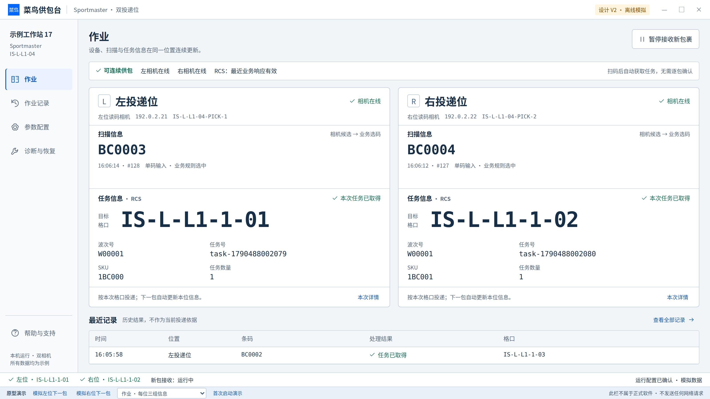
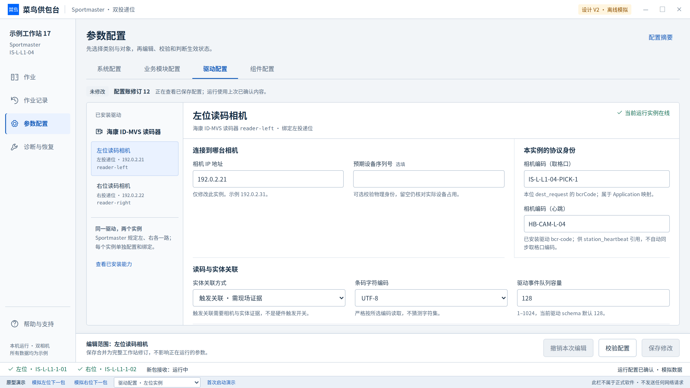
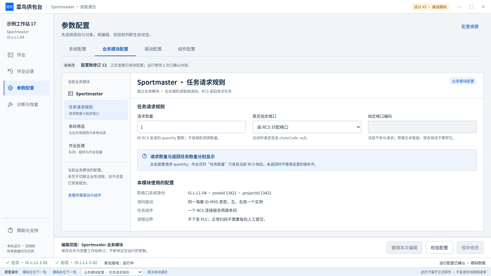

> 2026-10-22 当前权限语义以 [MANAGEMENT-MODE-01](../../work-packages/WP-IPC-MANAGEMENT-MODE-01.md) 为准：管理密码进入临时管理模式，不是管理员账号；操作员身份独立。四类参数、唯一候选、保存守卫和原业务合同继续有效。下述形成时界面与历史证据不倒写。

# Sportmaster UI 重设计 V2

**当前设计目标：参数按系统、业务模块、驱动、组件四类组织；首次配置独立于日常导航；每个左右相机框固定展示相机、扫描、RCS 任务三组信息。**

本包为 2026-10-20 的离线设计交付。已结合 `main` 的 `ba80d0ea90d86b24f9d9eebd20d075da34320972` 代码、文档、用户提供的产品 Demo 和最新接口要求梳理。完整 C#/WPF 实施属于下一步工作包；这些图和模拟交互没有宣称真实设备、Windows 或商业交付已通过验收。

## 直接查看与操作

| 交付 | 入口与使用 |
|---|---|
| 可点击离线原型 | [Prototype.html](Prototype.html)，下载后用浏览器打开，内嵌中文字体与脚本，无需安装或连接服务。GitHub 文件预览只显示源码，请下载文件打开。 |
| 逐张高清图 | 本页下方 **67 个独立 PNG 链接**；另有 [Gallery.html](Gallery.html) 可在下载本目录后离线浏览，点击缩略图打开原始大图。 |
| 开发交接 | [HANDOFF.md](HANDOFF.md)：任务、状态、按钮、字段归属、生效、诊断、迁移及实现依赖。 |
| 当前字段与原功能 | [54 条当前字段映射](data/ui-v2-field-migration.csv)、[58 条原字段/状态去向](data/ui-v2-original-field-overlay.csv)、[数据来源说明](data/README.md)。 |
| 必要走查结果 | [QA 记录](qa/README.md)，区分分阶段原型验证、最终图像复核、待做的 Windows/现场验收。 |
| 下一步实现 | [精简 Codex 提示](../../work-packages/Codex-WP-IPC-UI-TASK-REDESIGN-01.md)、[UIR-00～06 工作包](../../work-packages/WP-IPC-UI-TASK-REDESIGN-01.md)、[代码实施裁决](../../design/sportmaster-task-redesign-01.md)。 |
| 可编辑源文件 | [source/README.md](source/README.md)，独立模型、视图、样式、场景与构建/渲染脚本。 |
| 文件核对 | [FILES.json](FILES.json)，分别统计图片、源码、资料与 QA 文件，不把物理文件数称作设计页面数。 |
| 发布范围 | [V2 发布记录](../../runtime/ui-task-redesign-v2-publication-20261020.md)，列明代码基准、当前入口调整和生产实现边界。 |

**最新代码增量已纳入：** PARAM-01已有共享四类参数编辑、首配共模、字段定位与保存核对，当前仍为未完成快照；本设计继续完成它。业务模块加入已有条码筛选；系统/驱动分别展示取格口与心跳编码，组件保留5秒默认心跳间隔；扫描详情、心跳证据、单窗安装授权取消及回执未知均有明确状态。源码核对和实现边界见 [HANDOFF第0节](HANDOFF.md#0-最新-main-增量与复用边界)。

**数量口径：60 个命名界面状态，导出 67 张 PNG = 60 张状态图 + 5 张窗口尺寸变体 + 2 张表单滚动详情。** 它们覆盖同一组任务及状态，不代表有 60 个导航页面。54 条当前字段、58 条原字段/状态也不是图片数量。V1 的 95 指当时包含原型、源码、资料和打包件的物理文件总数；V1 与 V2 的数量不能混加成设计页面数。

<!-- PHYSICAL_COUNTS -->

本目录实际 **125 个文件**：高清PNG 67、可点击原型1、可编辑源/资源 19、字段/协议资料 6、各版本验证证据 27、索引/交接 4、文件清单1。没有将它们叫作设计页面，也没有把V1的旧文件混入本版计数。

<!-- END_PHYSICAL_COUNTS -->

## 本轮已经确定的产品结构

日常导航为 **作业、作业记录、参数配置、诊断与恢复**，底部提供帮助与支持。首次启动自动进入 **业务模块 → 系统配置 → 驱动配置 → 组件配置 → 检查与完成**，完成后进入作业。日常维护直接进入相应参数对象。

| 配置类别 | 用户正在配置谁 | 本轮明确归属 |
|---|---|---|
| 系统配置 | 当前供包台与本机 | 取格口 `zoneId`、`projectId`、`stationCode`；独立的心跳 `StationCode`；本地身份、目录、记录、磁盘、备份及显示偏好。 |
| 业务模块配置 | 当前已安装的 Sportmaster Application | `BarcodeFilter.Pattern` 条码筛选；请求 `quantity`、`specifiedChute`、条件必填 `chuteCode`；应用输入队列、调用超时、未清偿作业容量。 |
| 驱动配置 | 已安装驱动类型下的具体实例 | 相机 IP、可选序列号、实体关联、字符编码、驱动事件队列，以及本实例的取格口 `bcrCode` 与心跳 `bcr-code`。Sportmaster 规定左、右各一个实例。 |
| 组件配置 | 一个共享的 RCS 连接 | 接口地址、`source`、`locale`、请求编号区间、心跳间隔；其他三类的业务值只读引用，可跳到实际编辑位置。 |

四类是查找与编辑组织，底层仍由同一 Application 保存一份关联配置修订。取格口相机编码在驱动实例页维护，由 Application 持有映射；心跳 `bcr-code` 已是驱动声明参数。两者用途独立，不自动同步或覆盖。实例数依据业务模块与安装能力决定，不提供任意创建第三路相机或多个 RCS 连接的入口。

每个作业框中，**相机信息**确认左右位置与设备，**扫描信息**突出相机候选经业务规则选出的唯一码，原始候选及筛选详情可查，**任务信息**显示本次 RCS 格口、`waveNo`、`taskId`、`skuId`、返回数量。新条码到来时旧任务整组退出当前区，左右独立更新。请求数量与响应数量来源分别保留。

## 四条可实际点击的流程

### 1. 指定相机修改 → 错误 → 修正 → 保存 → 生效判断

1. 打开原型，在产品导航进入 **参数配置 → 驱动配置 → 左位读码相机**。标题、实例 ID、绑定位置和编辑范围同时确认对象。
2. 将相机 IP 改为示例错误 `192.0.2.999`，同时修改相机业务编码。点击 **校验配置**，错误摘要可定位 IP；另一个输入保留。
3. 改为示例 `192.0.2.31`，点击 **保存修改**。审阅本次关联变化，填写一条模拟维护说明，点击 **进入维护并保存**。原型模拟既有维护资格与整站暂停/排空，不要求输入真实密码。
4. 保存后明确显示 **已保存待受控重启**；实际运行仍是上次确认内容。点击 **受控重启**、确认范围，看到应用中，再看到新配置已确认。
5. 软件接收仍暂停，按实际准入条件另行 **恢复接收**，然后返回作业。生产实现须读取真实应用资格和启动证据。

底部审阅工具还可直接展示保存失败、保存结果待核对、应用失败、当前运行未知等分支。“运行未知”先只读核对状态，不默认重启或断言仍在运行旧配置。普通显示偏好即时保存，不走设备重启流程。

### 2. 左右连续作业与 RCS 异常恢复

在“作业 · 每位三组信息”场景，用底部 **模拟左位下一包 / 模拟右位下一包**观察：新条码进入本位，任务区进入处理中，匹配回应后整体显示本次格口及任务字段。右位的当前结果不被左位更新覆盖。

选择“作业 · RCS 响应异常”，从异常进入 **诊断与恢复**，检查运行对象和分层结果、查看原请求；展开明确标注的 **原型故障注入** 可模拟外部连接修复，再读取状态。地址恢复不会清除未知原件，也不会自动恢复接收。当前 RCS 没有权威查询能力，因此没有用业务 POST 冒充查询或连接测试。共享条件恢复后，健康位置可以按 Application 资格接收，未知原件仍阻断所属位。

### 3. 未保存离开与首次启动

修改参数后点击“作业”，实际演示 **继续编辑 / 保留草稿离开 / 放弃本次编辑**。切换同一配置候选内的类别或实例保留草稿，无需反复确认。原型保留属于内存模拟；生产复用既有加密持久草稿。

底部 **首次启动演示** 打开独立五步流程。它是设计审阅工具，不属于产品导航或正式快捷入口。底部场景选择会重置整份模拟状态；正常产品操作不会执行这种重置。

### 4. 业务模块条码规则与本地样例

进入 **参数配置 → 业务模块配置 → 条码筛选**，使用“填入演示规则”与本地候选样例，点击试读查看唯一匹配；修改样例后旧结果立即标为过期。两个相同条目仍是两个候选，不能去重成唯一结果。把规则改成示例错误 `[`，可看到规则字段错误及输入保留。此原型只支持预置模拟，真实 .NET 校验和有界执行必须复用 Application。

## 主要界面预览

### 作业：每位三组信息

### 参数：先类别，再实例

### 业务模块：任务请求规则

## 全部高清图：每张独立打开

设计基准为 1600×900 逻辑画布；常规图导出 3200×1800 PNG。目标工控机、观看距离和 Windows DPI 尚未确定，补图只代表对应逻辑空间的浏览器检查。表单滚动图展示同一页下半部分，类别、对象标题与保存区仍保持可见。

<!-- SCREENS_TABLE -->

| 编号 | 界面 / 状态（点击大图） | 覆盖的任务与决定 | PNG 像素 |
|---|---|---|---|
| 01 | [作业 · 每位三组信息](screens/01-work-normal.png) | 设备、相机条码、RCS 任务固定分组；波次、任务、SKU、数量及格口同件展示。 | 3200×1800 |
| 02 | [作业 · 左位条码已读，等待 RCS](screens/02-work-processing.png) | 只更新左位，旧任务字段整组失效；右位保持自己的结果。 | 3200×1800 |
| 03 | [作业 · 等待相机读码](screens/03-work-waiting.png) | 无当前条码或任务，不保留上一件格口，不增加逐包确认。 | 3200×1800 |
| 04 | [作业 · RCS 响应异常](screens/04-work-rcs-outage.png) | 共享故障说明两路新请求影响，原件责任逐位保留。 | 3200×1800 |
| 05 | [作业 · 左相机中断](screens/05-work-camera-outage.png) | 明确具体实例和影响；本场景右位仍具备准入条件。 | 3200×1800 |
| 06 | [作业 · 结果未知与明确拒绝](screens/06-work-unknown.png) | 本次条码保留，未知与拒绝分别表达，不提供伪查询或盲重试。 | 3200×1800 |
| 07 | [作业 · 当前状态失效](screens/07-work-stale.png) | 隐藏不可信的当前格口和任务字段，先恢复状态读取。 | 3200×1800 |
| 08 | [作业 · 长条码与任务字段](screens/08-work-long.png) | 完整展示长条码、波次、任务号和 SKU；长格口不截断。 | 3200×1800 |
| 09 | [作业 · 响应字段缺失](screens/09-work-fields-missing.png) | 未返回的波次或数量显示未返回，不拿请求数量或上一包补值。 | 3200×1800 |
| 10 | [系统配置 · 供包台身份](screens/10-system-station.png) | zoneId、projectId、stationCode 在系统中维护，业务规则通过独立类别引用。 | 3200×1800 |
| 11 | [系统配置 · 记录与备份](screens/11-system-records.png) | 本机历史、磁盘和备份，使用明确单位与范围。 | 3200×1800 |
| 12 | [系统配置 · 关闭计划备份](screens/12-system-backup-disabled.png) | 关闭后只取消未来调度，既有完整恢复集保留；条件字段停止校验和提交。 | 3200×1800 |
| 13 | [系统配置 · 本机偏好](screens/13-system-preferences.png) | 普通显示偏好单独即时保存，不进入运行参数的重启流程。 | 3200×1800 |
| 14 | [业务模块配置 · 任务请求规则](screens/14-business-rules.png) | 当前 Sportmaster 的请求数量、指定格口及条件必填字段，不切换 Application。 | 3200×1800 |
| 15 | [业务模块配置 · 指定格口校验失败](screens/15-business-chute-error.png) | 启用指定格口必须填写编码；错误就近显示，其他输入保留。 | 3200×1800 |
| 16 | [业务模块配置 · 作业处理](screens/16-business-runtime.png) | 当前 Application 的输入队列、调用超时与未清偿作业容量。 | 3200×1800 |
| 17 | [驱动配置 · 左位实例](screens/17-driver-left.png) | 同一已安装驱动下的左位配置，IP 与 bcrCode 对象归属明确。 | 3200×1800 |
| 18 | [驱动配置 · 右位实例](screens/18-driver-right.png) | 同驱动第二个实例，配置和位置独立；实例数量由业务模块决定。 | 3200×1800 |
| 19 | [驱动配置 · 编辑未保存](screens/19-driver-dirty.png) | 修改标记、当前对象与底部整站保存范围同时可见。 | 3200×1800 |
| 20 | [驱动配置 · IP 输入错误](screens/20-driver-invalid.png) | 错误定位当前实例，保留相机业务编码和其他输入。 | 3200×1800 |
| 21 | [驱动配置 · 两实例关联冲突](screens/21-driver-conflict.png) | 重复 IP 或相机编码指出关联对象，不静默覆盖另一实例。 | 3200×1800 |
| 22 | [驱动配置 · 正在检查编辑副本](screens/22-driver-checking.png) | 检查不保存、不启动新设备连接，不把格式检查等同读码成功。 | 3200×1800 |
| 23 | [参数配置 · 正在校验](screens/23-config-validating.png) | 完整候选校验期间保留表单，禁止重复提交，不改变实际运行值。 | 3200×1800 |
| 24 | [组件配置 · 单一 RCS 连接](screens/24-components.png) | 一个组件连接服务左右两位；站点和相机映射只读引用可跳转。 | 3200×1800 |
| 25 | [组件配置 · 地址可达性失败](screens/25-components-failed.png) | 按检查对象与层级说明失败，保留输入，定位接口地址。 | 3200×1800 |
| 26 | [保存配置 · 关联修改与影响](screens/26-config-save-review.png) | 所有关联修改一次审阅；保存前整站软件暂停、排空与既有维护认证。 | 3200×1800 |
| 27 | [保存配置 · 正在保存](screens/27-config-saving.png) | 保留表单与输入，防重复提交，展示整站范围。 | 3200×1800 |
| 28 | [保存配置 · 已确认未写入](screens/28-config-save-failed.png) | 只有获得写入前拒绝证据才显示未保存，草稿仍可修正。 | 3200×1800 |
| 29 | [保存配置 · 结果待核对](screens/29-config-save-unknown.png) | 可能落盘但回执失败，先比对候选与唯一配置账，禁止重复保存。 | 3200×1800 |
| 30 | [配置生效 · 已保存待重启](screens/30-config-pending.png) | 保存内容与实际运行内容分开，不能把保存成功当已生效。 | 3200×1800 |
| 31 | [配置生效 · 正在受控重启](screens/31-config-applying.png) | 采用当前 Restart 机制，读取启动确认后仍保持软件暂停。 | 3200×1800 |
| 32 | [配置生效 · 失败且旧运行已确认](screens/32-config-apply-failed.png) | 候选保留待生效，清楚说明当前仍用旧运行内容。 | 3200×1800 |
| 33 | [配置生效 · 当前运行待确认](screens/33-config-runtime-unknown.png) | 不知道正在运行哪份配置时不提供正常恢复。 | 3200×1800 |
| 34 | [配置生效 · 新内容已确认](screens/34-config-effective.png) | 新配置已得到启动确认，现场准入和恢复接收仍单独判断。 | 3200×1800 |
| 35 | [未保存离开 · 三个明确选择](screens/35-unsaved.png) | 继续编辑、保留草稿离开、放弃本次修改；范围与结果明确。 | 3200×1800 |
| 36 | [首次启动 · 业务模块](screens/36-setup-module.png) | 独立启动全窗，不显示日常侧栏；从已安装 Application 开始。 | 3200×1800 |
| 37 | [首次启动 · 系统配置](screens/37-setup-system.png) | 配置区域、项目、供包台编码与本机备份目录。 | 3200×1800 |
| 38 | [首次启动 · 驱动实例](screens/38-setup-devices.png) | Sportmaster 要求同一驱动两个相机实例，分别配置地址、编码与实体关联。 | 3200×1800 |
| 39 | [首次启动 · 组件连接](screens/39-setup-component.png) | 配置唯一 RCS 连接与协议参数，前面步骤的身份和规则只读引用。 | 3200×1800 |
| 40 | [首次启动 · 检查与完成](screens/40-setup-review.png) | 检查字段、装配与真实链路分层，保存和启动分别确认。 | 3200×1800 |
| 41 | [首次启动 · 已保存尚未启动](screens/41-setup-pending.png) | 保存完成后仍明确提示待启动，不提前进入正常作业。 | 3200×1800 |
| 42 | [首次启动 · 启动已确认](screens/42-setup-complete.png) | 完成后进入作业，后续修改直接进入四类参数配置。 | 3200×1800 |
| 43 | [作业记录 · 查询与任务详情](screens/43-history.png) | 按稳定查询快照展示，包含对应任务字段。 | 3200×1800 |
| 44 | [作业记录 · 无匹配结果](screens/44-history-empty.png) | 保留筛选，说明当前查询范围并提供清除入口。 | 3200×1800 |
| 45 | [作业记录 · 日期范围错误](screens/45-history-invalid.png) | 定位筛选关系，保留其他输入。 | 3200×1800 |
| 46 | [诊断 · RCS 异常与原请求](screens/46-diagnostics-outage.png) | 心跳 HTTP 证据、业务确认与原请求责任分层显示，连接恢复不清偿原件。 | 3200×1800 |
| 47 | [诊断 · 地址恢复，原件仍待核对](screens/47-diagnostics-recovered.png) | 模拟修复外部连接后重新读取；网络恢复不清除原件责任。 | 3200×1800 |
| 48 | [维护 · 备份与配置迁移](screens/48-maintenance.png) | 完整恢复集与安全模板分开，按对象预览和受控恢复。 | 3200×1800 |
| 49 | [迁移 · 旧左右供包台编码不一致](screens/49-migration-conflict.png) | 保留两个原值，明确处置后才能合并为系统 stationCode。 | 3200×1800 |
| 50 | [支持 · 诊断摘要预览](screens/50-support-preview.png) | 时间、对象、内容与秘密排除清楚，导出同一份有效预览。 | 3200×1800 |
| 51 | [安装维护 · 普通 Windows 交付](screens/51-install-review.png) | 同窗自动准备、本地摘要、安装时一次 Windows 授权；普通客户端首次需要时再进入独立配置。 | 3200×1800 |
| 52 | [紧凑显示 · 1366 × 768](screens/52-work-1366x768.png) | 逻辑视口检查，不能代替实际 Windows DPI 验收。 | 2732×1536 |
| 53 | [长字段 · 1280 × 720](screens/53-work-long-1280x720.png) | 约对应 1920 × 1080、150% 缩放的逻辑空间，非 Windows 实测。 | 2560×1440 |
| 54 | [最小逻辑窗口 · 800 × 420](screens/54-work-minimum-800x420.png) | 保留三组核心信息和本次操作，较低空间采用紧凑显示。 | 1600×840 |
| 55 | [窗口不足 · 799 × 419 保护](screens/55-display-protection-799x419.png) | 不支持的窗口显示保护提示；生产保留既有恢复确认。 | 1598×838 |
| 56 | [紧凑参数页 · 字段错误](screens/56-driver-invalid-1280x720.png) | 对象、类别及保存固定可见，滚动仅发生在当前表单内。 | 2560×1440 |
| 57 | [组件配置 · 下方参数与引用](screens/57-components-lower.png) | 同一 RCS 页面向下滚动，仍显示对象头、分类与保存范围。 | 3200×1800 |
| 58 | [系统配置 · 下方计划备份](screens/58-system-backup-lower.png) | 同一系统页面向下滚动，完整显示计划开关、目录与周期。 | 3200×1800 |
| 59 | [业务模块 · 条码筛选](screens/59-business-barcode.png) | 沿已有 Application 筛选合同；预置样例仅模拟，不执行用户正则。 | 3200×1800 |
| 60 | [条码筛选 · 规则错误](screens/60-business-barcode-error.png) | 本次规则错误就近定位，其他输入与运行规则保留。 | 3200×1800 |
| 61 | [多候选 · 唯一选中](screens/61-work-filter-selected.png) | 相机原始候选经当前业务规则选出唯一条码，再取得本次任务。 | 3200×1800 |
| 62 | [条码筛选 · 无匹配](screens/62-work-filter-none.png) | 本次没有匹配条码，不请求 RCS；旧格口不能作为本次结果。 | 3200×1800 |
| 63 | [条码筛选 · 多码歧义](screens/63-work-filter-multiple.png) | 多个匹配条目均保留，不自动去重或让操作员手动选码。 | 3200×1800 |
| 64 | [本次输入详情 · 候选与规则](screens/64-work-filter-details.png) | 保序候选、完整性、筛选结论与规则指纹；不人工选码、不构造RCS请求。 | 3200×1800 |
| 65 | [安装 · 同窗自动准备](screens/65-install-preparing.png) | 准备阶段检查版本与完整性，不请求管理员授权；允许取消并保留选项。 | 3200×1800 |
| 66 | [安装 · 授权取消](screens/66-install-cancelled.png) | 取消授权没有安装成功回执；保留本地审核摘要供明确续办。 | 3200×1800 |
| 67 | [安装 · 回执待核对](screens/67-install-receipt-unknown.png) | 保留原次安装摘要，先核对回执，不能因结果未知重复执行安装。 | 3200×1800 |

<!-- END_SCREENS_TABLE -->

## 来源、适用边界与下一步

V1 已保存的 [原截图功能清单](../sportmaster-task-redesign-20261020/handoff/data/workflow-inventory.md)、[参数事实](../sportmaster-task-redesign-20261020/handoff/data/parameter-inventory.md)和[操作迁移表](../sportmaster-task-redesign-20261020/handoff/data/action-migration.csv)继续作为原始证据。本版将与新要求冲突的旧导航、分类和数据展示明确标为历史，当前入口统一到 V2；不删除原始编号和审查记录。

用户提供的两个产品 Demo HTML 内容相同，本轮实际查看并采用三组信息组织；手工提交、AGV、周转箱及随机模拟逻辑不进入 Sportmaster 正常作业。原始客户 HTML/截图不随本次衍生设计公开上传。请求/响应 JSON 是用户本轮给出的示例的干净转写，例值不是默认值。

源代码已有 `taskId` / `skuId` 的解析和传递；新增 `waveNo` 与响应 `quantity` 的兼容 DTO、历史读取及投影属于下一步完整实施。配置沿现有唯一账、CAS、加密草稿与 Restart 生命周期；重连不应用 Pending。旧左右 `stationCode` 不同须显式处理。所有请求保持原冻结目标和报文，不能随新配置重写历史。

六项商业质感已进入工作包与 Codex 提示：重点清楚、组织一致、密度合适、状态完整、操作连贯、真实显示可靠。下一轮只做改动及真实风险所需的验证，并分别记录原型、WPF、Windows 实际输入/DPI、真实设备和现场验收。集中待确认项见 [交接 §9.3](HANDOFF.md#93-优先级与少量待确认)。
