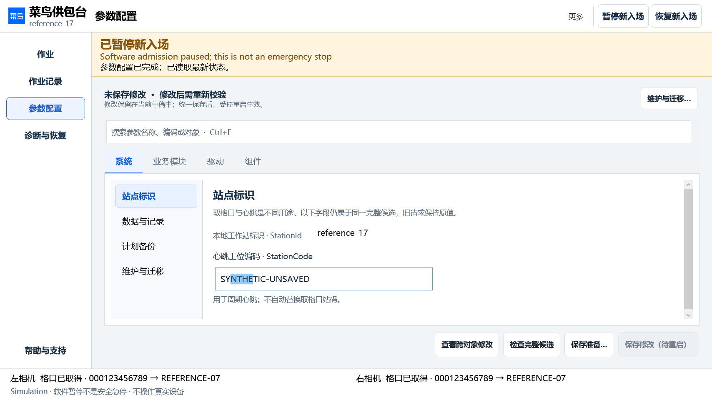
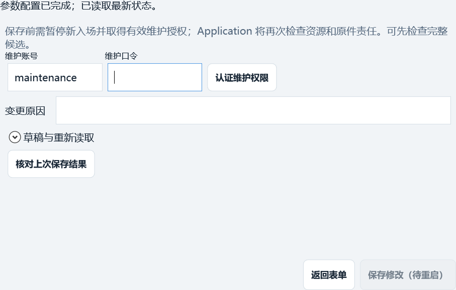
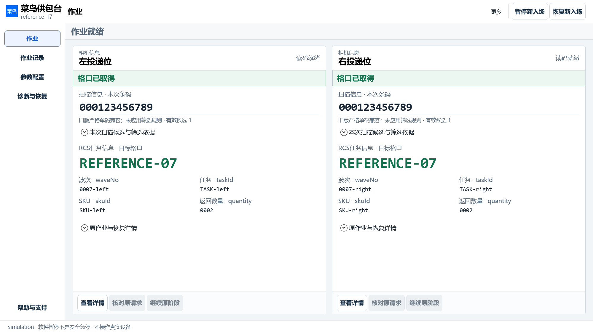

# Sportmaster V2 · 同源 WPF 高清界面

生产代码固定于 **`26bb7b9488b98cc0ce44ef6cf74df7c493153b0a`**。32 张 PNG 来自真实 WPF HWND/Dispatcher 及合成业务数据，8 张 JPEG 是本机 Windows 原生输入/启动截图。不是 HTML 原型，也不是现场设备验收。每个文件的 SHA256、尺寸、15 个发布 DLL 的身份见 [PROVENANCE.json](PROVENANCE.json)；完整验证见 [验收记录](../../runtime/evidence/ui-task-redesign-v2/ACCEPTANCE.md)。

PNG 以本机 125% 缩放捕获原生控件 backing；例如 1600×900 DIP 输出 2000×1125 像素。控件单独展示的图不含主壳，不能与整窗尺寸混算。未对图片作修饰；界面中的地址、条码、波次、任务、站点和授权文本均为合成测试数据。

## 参数页续修

常用字段先显示，安装身份展开查看；搜索可以跨分类直接定位原控件。保存认证和原因放在独立窗口，返回后保留输入与编辑区高度。底栏保存继续受 Application 准入约束，不以视觉“可点击”绕过真实权限。

| 图 | 范围 |
|---|---|
| [跨分类搜索](parameters-search.png) | 完整主壳；结果定位当前字段，保留草稿 |
| [业务规则](parameters-business-rules.png) | 独立实际共享编辑器；条码与请求规则 |
| [右相机](parameters-right-driver.png) | 独立实际共享编辑器；真实参数描述和两种 bcrCode |
| [RCS 连接](parameters-rcs-component.png) | 独立实际共享编辑器；常用字段和折叠安装详情 |
| [站码迁移冲突](parameters-station-conflict.png) | 两原值保留，要求显式决定 |
| [字段错误定位](parameters-errors.png) | 协议目标与请求号段错误、可定位列表 |

## 作业、记录与诊断

| 状态 | 图 |
|---|---|
| 等待 / 左处理右完成 | [等待](work-waiting-1600.png)、[处理中](work-processing-1600.png) |
| 关联任务 / 较窄布局 | [1600×900 DIP](work-assigned-1600.png)、[1366.4×768 DIP](work-assigned-1366.png) |
| 新观察被拒绝 / Unknown / 过期 | [新输入拒绝](work-rejected-new-input.png)、[Unknown](work-unknown.png)、[过期](work-stale.png) |
| 原请求记录 / 对象诊断 | [记录](history.png)、[诊断](diagnostics.png) |
| Unknown 原责任与新输入拒绝并存 | [1600×900](supply-station-v2-client-1600x900-unknown-rejection.png)、[1440×768](supply-station-v2-client-1440x768-unknown-rejection.png)、[1100×600](supply-station-v2-client-1100x600-unknown-rejection.png)、[911.2×512](supply-station-v2-client-911x512-unknown-rejection.png)、[800×420](supply-station-v2-client-800x420-unknown-rejection.png) |

## 首配和关闭保护

五步均为最终发布 `Ipc.Desktop.dll` 的实际启动控件。缺扩展库存场景明确保留阻断，未画成已就绪。

| 场景 | 图 |
|---|---|
| 五步首配 | [1 业务模块](startup-step-1.png)、[2 系统](startup-step-2.png)、[3 驱动](startup-step-3.png)、[4 组件](startup-step-4.png)、[5 检查与完成](startup-step-5.png) |
| 三种离开选择 | [继续编辑](unsaved-cancel.png)、[保留或放弃](unsaved-decision.png) |
| 保留失败与多窗口 | [失败前](unsaved-before-failure.png)、[加密保留失败](unsaved-save-failed.png)、[多窗独立草稿](unsaved-multiple.png) |

## Windows 实际输入和发布程序

本机 Windows 11 家庭中文版 10.0.22631 x64，125%，工作区 1536×816 DIP。[操作记录](native/INPUT-RECORD.txt)记录输入 `FINAL-DRAFT-125`、Ctrl+F 搜索/Enter 定位、保存准备及返回。没有提交配置、提供凭据或控制设备。

| 场景 | 原生截图 |
|---|---|
| 真实主窗与参数输入 | [作业](native/work.jpg)、[参数](native/parameters.jpg) |
| 搜索与精确草稿保留 | [搜索](native/search.jpg)、[返回字段](native/draft-retained.jpg) |
| 独立保存准备与返回 | [保存准备](native/save-preparation.jpg)、[返回表单](native/return-from-save.jpg) |
| 实际发布 EXE，隔离空配置 | [离线维护](native/published-maintenance.jpg)、[恢复入口](native/published-recovery.jpg) |

这些是本机窗口实际截图；PNG 布局矩阵、此处键鼠输入与真实设备验收分别计证。其他 Windows、DPI、触摸、目标工控机和真实 SDK/RCS 尚未验证。
