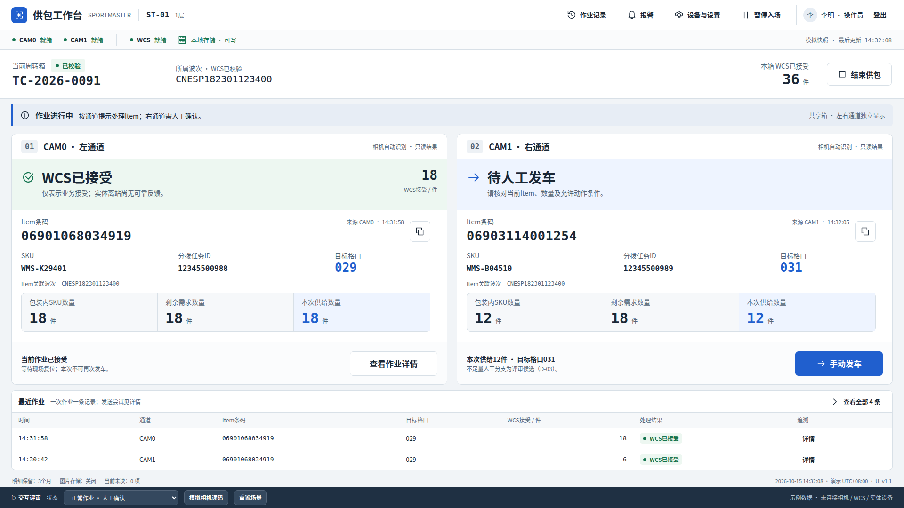

# 供包工作站最终交付 UI 设计基线 · v1.1

本目录实际保存 SS-UI-VIS-001 v1.1 的设计原文件、可编辑画板和全部34个页面/状态/窗口图位。版本依据是本设计会话最后一次完整交付，不以另一会话的版本号或未导出的Canva更新时间判断更晚定稿。

## Codex 必须先读

先查看下方主工作台和 [全部状态图](GALLERY.md)，再阅读 [开发交接全文](docs/供包工作站_UIUX设计与开发交接说明.md)、[原交互HTML](供包工作站_高保真交互原型.html)、[分离源码](prototype/index.html) 和 [tokens](design/tokens.json)。不能再仅凭说明文字、接口字段或当前WPF调试界面猜布局。

## 直接使用的文件

|内容|位置|
|---|---|
|34张独立PNG与预览|[图册](GALLERY.md)、screens/|
|自包含可交互HTML|[供包工作站_高保真交互原型.html](供包工作站_高保真交互原型.html)|
|分离HTML/CSS/JavaScript|[prototype/index.html](prototype/index.html)、[workstation.css](prototype/workstation.css)、[workstation.js](prototype/workstation.js)|
|18页可编辑PPTX|[供包工作站_可编辑UI画板_v1.1.pptx](design/供包工作站_可编辑UI画板_v1.1.pptx)|
|18页元素坐标/图形源|[editable-boards.json](design/editable-boards.json)|
|颜色、字号和布局变量|[tokens.json](design/tokens.json)、[tokens.css](design/tokens.css)|
|完整设计规范、PAGE/REQ映射和开发交接|[UIUX设计与开发交接说明](docs/供包工作站_UIUX设计与开发交接说明.md)|
|离线全图册|[界面图册.html](界面图册.html)|
|来源及逐文件校验|[source-manifest.json](source-manifest.json)、[render-verification.json](render-verification.json)、[publication-checks.json](publication-checks.json)|

GitHub文件页面可查看PNG、Markdown和源码；交互HTML需要克隆仓库后用浏览器本地打开。HTML无CDN依赖、禁止真实相机/WCS/实体调用；底部评审控制台切换原有44种场景。它是设计载体，不改变Windows/WPF生产技术路线。

## 精确的来源与验收边界

11份源文件与原v1.1交付ZIP内对应文件逐字节一致；原README另存为README.source.md，其“本次/evidence/tools”等描述属于2026-10-15原交付，不代表本次上传重跑了历史验证。

**本目录34张PNG是此次由原样HTML在隔离Chromium重新导出的图片，不是原交付ZIP里的历史PNG字节，也不是Windows客户端运行截图。** 重新导出未修改HTML/CSS/JS；字体和渲染器差异可能改变细微排版。逐张尺寸、场景、哈希与渲染环境已登记。截图只证明该设计状态的视觉导出，不能证明按钮、SDK、实际WCS或现场验收通过。

可编辑PPTX保持原字节。已知部分.png命名媒体实际是SVG；不将保存源文件宣称为PowerPoint/Canva跨渲染器排版通过，也不冒充新的Canva导出。没有包含字体文件或厂商SDK。

## 设计与实现的取舍

本组资料作为已交付视觉与交互意图基线，**不是业务规则和旧HTML逻辑的自动批准**。必须同时读取 [框架设计](../../design/framework.md)、[当前运行入口](../../INDEX.md)、[未关闭评审](../../reviews/STATUS.md)。D/RV仍由原登记和实际修复证据决定。继承专业信息层级，不复制已知gate/恢复/计数/焦点缺陷，不降低当前应用守卫来模仿原型成功。

布局保持共享箱/波次、双通道当前任务/条码/数量/结果、持续异常、固定主操作、最近记录。工程控制不能取代操作工作台；模拟标识必须保留，真实未知字段不得补造。新的WPF实现需另交实际Windows运行图和交互证据。

原客户PRD、原产品HTML及私密来源、其他受限设计/评审附件没有随本目录上传，完整客户资料归档仍未闭环。文件库另一会话v2.1包未取得可核验原字节，未将其冒称当前稿。原交付历史证据引用不在本目录时，按未随本次上传处理，不造空文件。

## 重新导出这些图

可选导出工具：Python、Playwright 1.56.0、其Chromium、Pillow和系统简体中文字体；打开单文件HTML本身不需要Python。安装上述依赖后执行 `python docs/ui/ss-ui-vis-001-v1.1/tools/reexport_screenshots.py`。工具只切换设计场景和截图，阻断外联，不执行现场业务测试。
